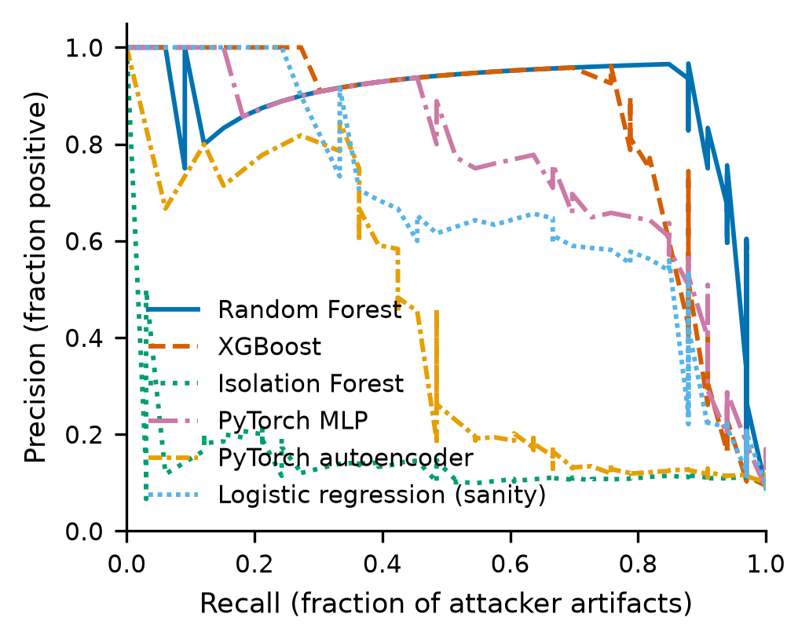
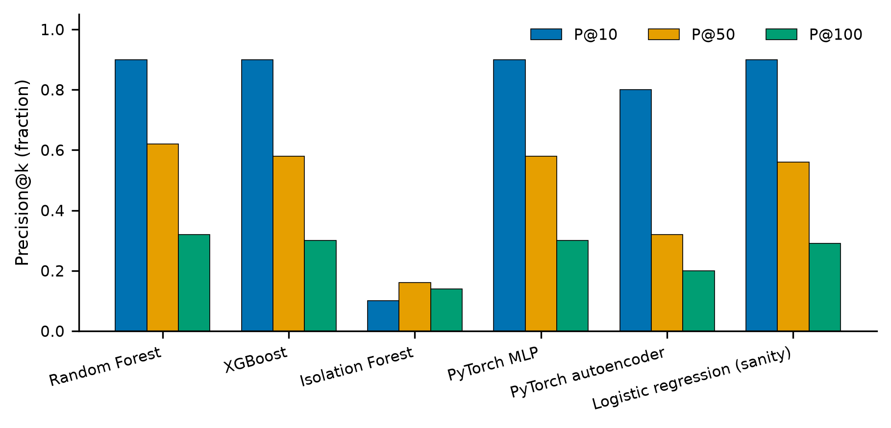
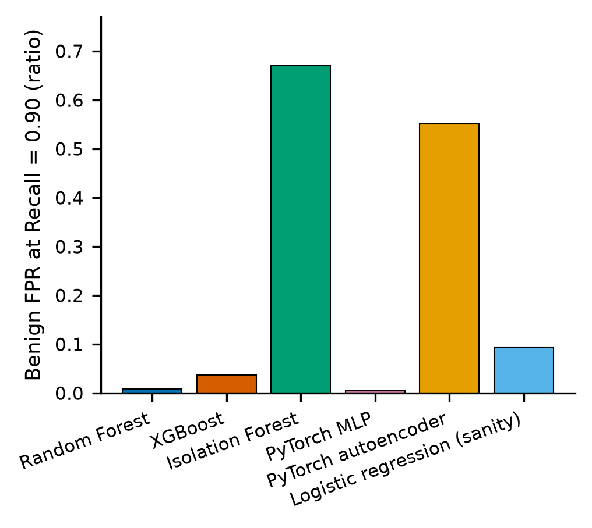
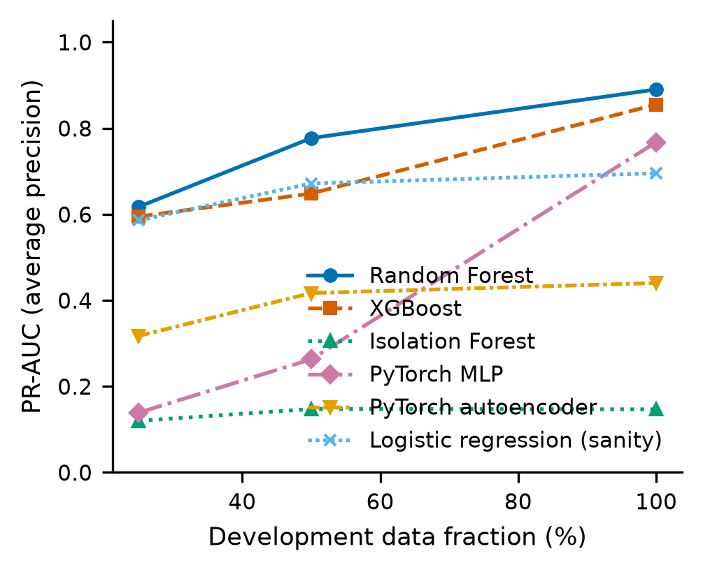
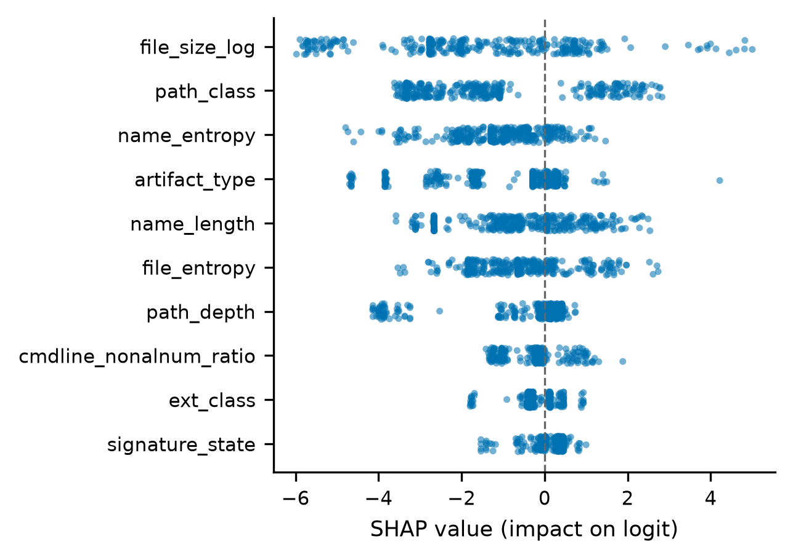
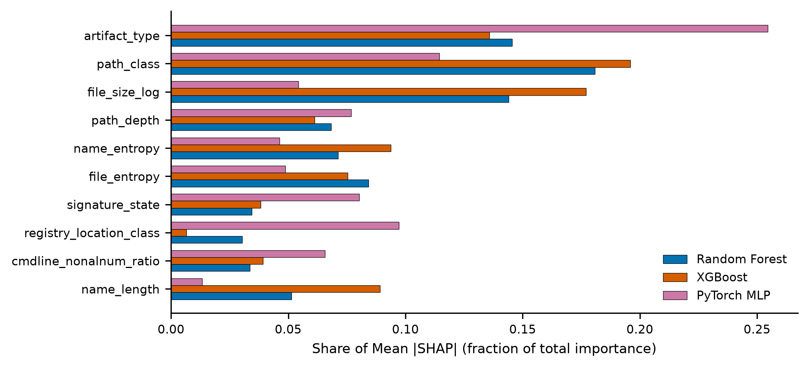
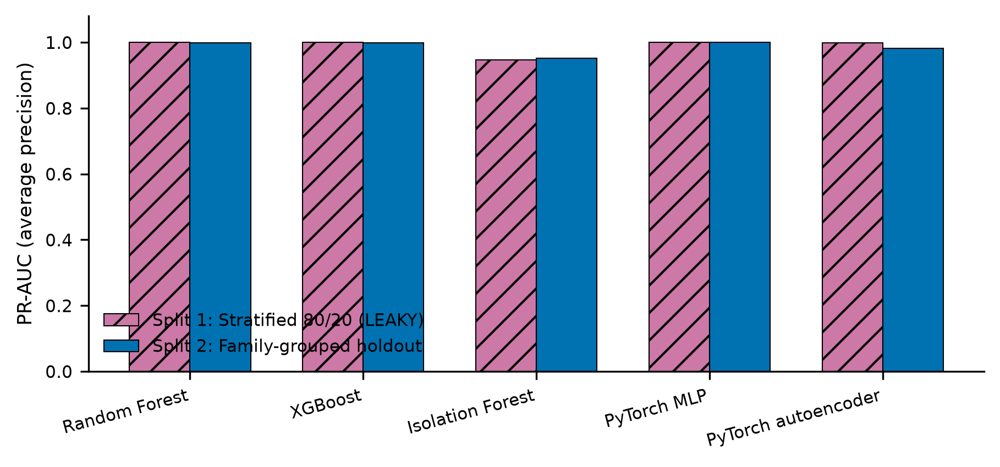
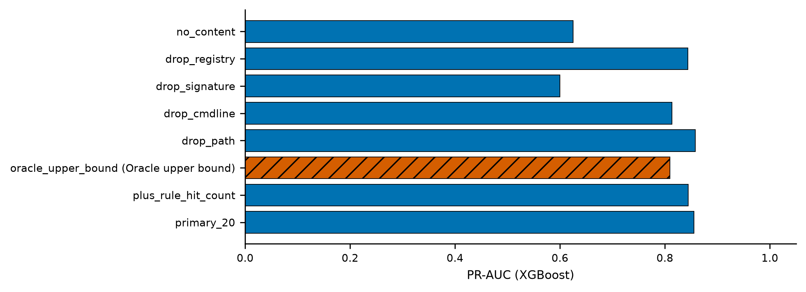
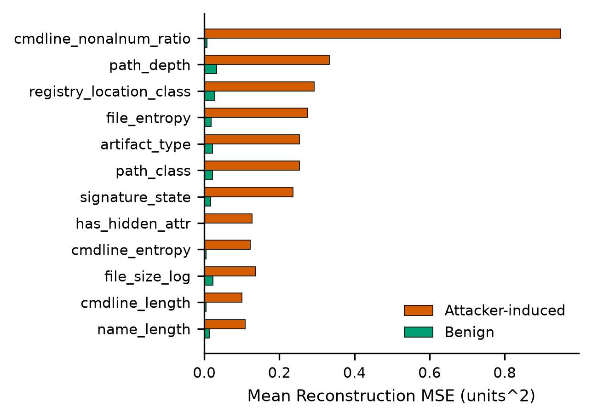
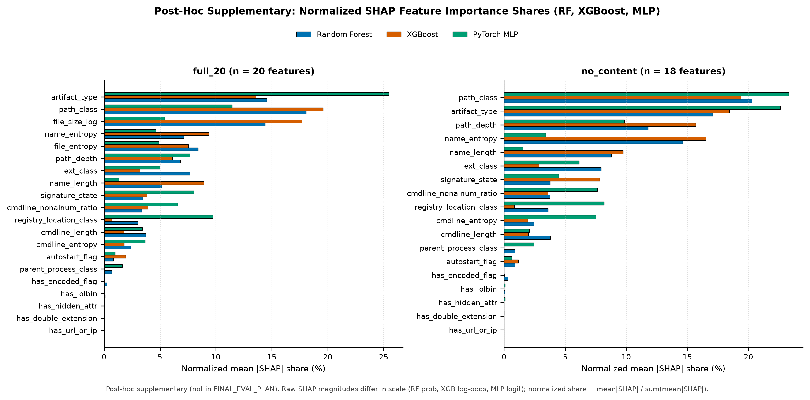

# DFIR-Triage / REVENANT Phase 1 ML Benchmark — Complete Technical Report

**Generated:** 2026-11-22  
**Repository:** `dfir-triage-ml` (branch `main`)  
**Core Layering Principle:** *"Rules prove, the model ranks, the human decides."* (`src/config.py`)  
**Documentation Index:** [docs/INDEX.md](docs/INDEX.md) | **Pre-Registered Protocol:** [docs/FINAL_EVAL_PLAN.md](docs/FINAL_EVAL_PLAN.md) | **Improvement Audit:** [docs/IMPROVEMENT_ANALYSIS.md](docs/IMPROVEMENT_ANALYSIS.md) | **v2 Plan:** [docs/v2/V2_PLAN.md](docs/v2/V2_PLAN.md) | **Overview:** [README.md](README.md)

---

## 1. Executive Summary & Headline Findings

`dfir-triage-ml` implements an auditable, local, read-only Windows host-artifact triage prioritization layer across **6 ML models** (`rf`, `xgb`, `lr`, `mlp`, `ae`, `iforest`) and **3 non-ML baselines** (`rules_binary`, `rules_count`, `random`):

* **Track A (Core Host-Artifact Benchmark):** `51 / 51` live isolated Windows 11 VM runs (`3` control boots + `48` attack runs across `16` MITRE ATT&CK techniques $\times$ `3` variants) produced `1,549` deduplicated rows (`103` `attacker_induced`, `380` `benign_drift`, `1,066` `baseline`) in [`data/processed/dataset_v1.parquet`](data/processed/dataset_v1.parquet) and [`data/processed/dataset_stats.csv`](data/processed/dataset_stats.csv), partitioned strictly by `technique_id` (`11` dev / `5` holdout) and SHA-256 hash-bucketed benign keys (`0` dev/test overlaps).
* **Pre-`--final` Bug Fix & Dual-Configuration Pre-Registration:**
  * Commit `8add423` fixed `_SIG_MAP["unknownerror"] = "na"` in [`src/data/features.py`](src/data/features.py) prior to any frozen test evaluation (`0` changed labels, updating `test_sha256` to `0f1ff3ec054bf00c66875fb5d2466e3b8d35685d69c2f0203d6787b71852ffa8`; [`data/splits/dataset_v1_manifest.json`](data/splits/dataset_v1_manifest.json)).
  * Commits `4e32ab1` and `69ad02e` pre-registered dual-configuration evaluation across **`full_20`** (20 locked features) and **`no_content`** (18 features dropping `file_size_log` and `file_entropy`) in [`docs/FINAL_EVAL_PLAN.md`](docs/FINAL_EVAL_PLAN.md) to quantify benign script template quantization (`221` benign dev scripts mapped to `18` unique sizes and `30` `(file_size_log, file_entropy)` pairs).
  * Executed `--final --include-lr --dual-config` **once** (`timestamp_utc = "2026-11-22T02:04:38Z"`, [`results/logs/final_eval_audit.jsonl`](results/logs/final_eval_audit.jsonl)).
* **Headline Frozen Test Performance (`n = 370`, `33` positives across `5` holdout techniques):**
  * **Random Forest (`rf`)** achieves the highest point PR-AUC in both configurations: **`0.8902`** (`[0.7605, 0.9887]` 95% `run_id` CI; [`results/tables/track_a_test_results.csv`](results/tables/track_a_test_results.csv)) in `full_20` and **`0.7078`** (`[0.5270, 0.8410]`; [`results/tables/no_content/track_a_test_results.csv`](results/tables/no_content/track_a_test_results.csv)) in `no_content`, with `P@10 = 0.9000` in both and `0.9821` (`full_20`) / `0.7586` (`no_content`) on the `file+run_key+task` hard-negative view ([`results/tables/track_a_test_by_artifact_type.csv`](results/tables/track_a_test_by_artifact_type.csv)).
  * **ML vs. Rules:** Both `rf` (`+0.6421` `full_20` / `+0.4597` `no_content`) and `xgb` (`+0.6071` / `+0.3768`) significantly outperform `rules_binary` (`0.2481`; [`results/tables/track_a_test_baselines.csv`](results/tables/track_a_test_baselines.csv)) across every evaluated slice in both configurations (`dual_verdict = a_better`; [`results/tables/track_a_test_dual_config_verdict.csv`](results/tables/track_a_test_dual_config_verdict.csv)).
  * **No Strict ML Overall Winner:** Under the dual-configuration paired bootstrap rule (`xgb vs rf` = `configuration-dependent`, `xgb vs mlp` = `not distinguishable`, `rf vs mlp` = `configuration-dependent`), no single ML architecture statistically dominates across both feature sets on `33` test positives / `5` techniques ([`results/tables/track_a_test_dual_config_verdict.csv`](results/tables/track_a_test_dual_config_verdict.csv)).
* **Headline Track B (`CIC-MalMem-2022`, Secondary / Appendix Benchmark):**
  * Public memory-forensics dataset (`Obfuscated-MalMem2022.csv`, `58,596 x 57`, MD5 `7a969ce248207e80af81bdf73601601a`; [`results/logs/track_b_meta.json`](results/logs/track_b_meta.json)) shows saturated scores on leaky Split 1 (`1.0000` PR-AUC; [`results/tables/track_b_split1.csv`](results/tables/track_b_split1.csv)), while family-grouped Split 2 exposes benign-shift test-FPR inflation (`8.1%–22.3%` at nominal 1% benign-val FPR; [`results/tables/track_b_split2.csv`](results/tables/track_b_split2.csv)). Track B is strictly a **secondary/appendix analysis** on a different task and data modality (memory-dump features, malware vs. benign classification) and is **not** part of the Track A host-artifact triage model ranking.

---

## 2. Models & Non-ML Baselines (Complete Specification of All 9 Arms)

All 6 ML arms share a uniform interface (`fit`, `predict_scores`, `save`, `load`) and preprocess inputs exclusively through [`src/models/preprocess.py`](src/models/preprocess.py) (`SharedPreprocessor`: categorical `"na"` imputation + `OneHotEncoder(handle_unknown="ignore")`; numeric `SimpleImputer(strategy="constant", fill_value=0, add_indicator=True, keep_empty_features=True)` + `StandardScaler`; binary `fillna(0)` passthrough). On Track A dev rows (`1,179` rows), encoded dimensionality is **`55`** (`full_20` supervised), **`53`** (`full_20` unsupervised benign-only, fewer missingness/category indicators observed in benign-only fit), and **`51`** (`no_content` supervised). All Track A arms use global **`SEED = 42`** ([`src/config.py`](src/config.py)); during dev CV, seeds `DEV_CV_SEEDS = [0, 1, 2]` are used per fold ([`src/eval/run_track_a.py`](src/eval/run_track_a.py)).

### 2.1 Complete Inventory of the 6 ML Models & 3 Non-ML Baselines

| Arm Key | Type | Trains On | Architecture & Implementation | Dev-Only Tuning Budget & Search Space | Final Chosen Params (`full_20` \| `no_content`) | Seed | Library & Version (`requirements.txt`, `track_a_final_meta.json`) |
| :--- | :--- | :--- | :--- | :--- | :--- | :---: | :--- |
| **`rf`** (`RandomForestArm`) | Supervised classical ensemble | All dev rows (`1,179`: `70` pos, `1,109` neg) | `RandomForestClassifier(class_weight="balanced_subsample", n_jobs=-1)` ([`src/models/sklearn_models.py`](src/models/sklearn_models.py)) | `20` random trials × 3 seeds × 5-fold `GroupKFold` (`track_a_dev_trials.csv`); `n_estimators` `[200..500]`, `max_depth` `[None,10..30]`, `min_samples_leaf` `[1..5]` | `max_depth=20, min_samples_leaf=1, n_estimators=500` (both) | `42` | `scikit-learn==1.9.1` |
| **`xgb`** (`XGBoostArm`) | Supervised gradient-boosted trees | All dev rows (`1,179`) | `XGBClassifier(tree_method="hist", scale_pos_weight=n_neg/n_pos [=1109/70=15.8429], eval_metric="logloss", n_jobs=-1)` ([`src/models/sklearn_models.py`](src/models/sklearn_models.py)) | `20` random trials × 3 seeds × 5-fold dev CV; `n_estimators` `[200..600]`, `learning_rate` `[0.03..0.2]`, `max_depth` `[3..8]` | `learning_rate=0.15, max_depth=3, n_estimators=500` (both) | `42` | `xgboost==3.4.1` |
| **`lr`** (`LogisticRegressionArm`, optional sanity) | Supervised linear model | All dev rows (`1,179`) | `LogisticRegression(class_weight="balanced", max_iter=1000)` ([`src/models/sklearn_models.py`](src/models/sklearn_models.py)) | `5` exhaustive grid trials × 3 seeds × 5-fold dev CV; `C` `[0.01, 0.1, 1.0, 10.0, 100.0]` | `C=100.0` (both) | `42` | `scikit-learn==1.9.1` |
| **`mlp`** (`TabularMLPArm`) | Supervised deep tabular NN | All dev rows (`1,179`) via grouped inner val split (`_split_inner_grouped_val`, `run_track_a.py`) | `Input -> Linear(128) -> BatchNorm1d -> ReLU -> Dropout(0.3) -> Linear(64) -> BatchNorm1d -> ReLU -> Dropout(0.2) -> Linear(32) -> ReLU -> Linear(1)`; `BCEWithLogitsLoss(pos_weight=n_neg/n_pos)`, `AdamW`, early stop on grouped val PR-AUC (`max_epochs=200, patience=10`; [`src/models/mlp.py`](src/models/mlp.py)) | `20` random trials × 3 seeds × 5-fold dev CV; `batch_size` `[256,512,1024]`, `lr` `[1e-3..1e-2]`, `weight_decay` `[1e-4..1e-2]` | `full_20`: `batch_size=256, lr=0.005, weight_decay=0.0003`; `no_content`: `batch_size=512, lr=0.003, weight_decay=0.01` | `42` | `torch==2.15.0` (`2.15.0+cu132`, CUDA) |
| **`ae`** (`DeepAutoencoderArm`) | **Unsupervised** deep autoencoder | **Benign-only** dev rows (`1,109`: `821` baseline + `288` drift; `n_attack_seen_in_fit_=0`; preproc fit on benign only) | `Input -> Linear(64) -> ReLU -> Linear(32) -> ReLU -> Linear(16) -> Linear(32) -> ReLU -> Linear(64) -> ReLU -> Linear(Input)`; `MSELoss`, `AdamW`, score = per-row MSE, early stop on grouped benign val MSE (`max_epochs=200, patience=10`; [`src/models/autoencoder.py`](src/models/autoencoder.py)) | `20` random trials × 3 seeds × 5-fold dev CV (hyperparameters chosen by dev OOF PR-AUC per `docs/specs/04_approaches_and_datasets.md`); `batch_size` `[256..1024]`, `lr` `[1e-3..1e-2]`, `weight_decay` `[0..1e-3]` | `batch_size=256, lr=0.005, weight_decay=0.0` (both) | `42` | `torch==2.15.0` (`2.15.0+cu132`, CUDA) |
| **`iforest`** (`IsolationForestArm`) | **Unsupervised** classical tree outlier | **Benign-only** dev rows (`1,109`; `n_attack_seen_in_fit_=0`; preproc fit on benign only) | `IsolationForest(n_jobs=-1)`, score = `-decision_function(X)` ([`src/models/sklearn_models.py`](src/models/sklearn_models.py)) | `10` exhaustive grid trials × 3 seeds × 5-fold dev CV; `n_estimators` `[100..300]`, `max_samples` `["auto", 256]` | `max_samples="auto", n_estimators=100` (both) | `42` | `scikit-learn==1.9.1` |
| **`rules_binary`** | Non-ML deterministic baseline | None (no training) | `(rule_hit_count > 0).astype(float)` from `RULE-001..RULE-015` ([`src/eval/run_track_a.py`](src/eval/run_track_a.py), [`src/rules/deterministic_rules.py`](src/rules/deterministic_rules.py)) | None | N/A | N/A | Python `3.12.16` |
| **`rules_count`** | Non-ML deterministic baseline | None (no training) | Ranks strictly by integer `rule_hit_count` (`src/eval/run_track_a.py`) | None | N/A | N/A | Python `3.12.16` |
| **`random`** | Non-ML stochastic baseline | None (no training) | Uniform random draw `np.random.default_rng(42).random(len(df))` ([`src/eval/run_track_a.py`](src/eval/run_track_a.py)) | None | N/A | `42` | `numpy==2.5.5` |

Sources: [`results/tables/track_a_best_params.json`](results/tables/track_a_best_params.json), [`results/tables/no_content/track_a_best_params.json`](results/tables/no_content/track_a_best_params.json), [`results/tables/track_a_dev_trials.csv`](results/tables/track_a_dev_trials.csv), [`src/config.py`](src/config.py), [`requirements.txt`](requirements.txt). *(On Track B, all 5 mandatory arms use fixed `DEFAULT_PARAMS` in `src/config.py:216-222` without hyperparameter search.)*

### 2.2 Training & Inference Latency (Seconds per Run / per 1,000 Rows)

| Arm / Baseline | Track A Frozen Test `full_20` Train (s) \| Infer/1k (s) | Track A Frozen Test `no_content` Train (s) \| Infer/1k (s) | Track A Dev CV Timing | Track B Split 1 Train (s) \| Infer/1k (s) | Track B Split 2 Train (s) \| Infer/1k (s) |
| :--- | :---: | :---: | :---: | :---: | :---: |
| **`rf`** | `0.7897` \| `0.1458` | `0.7636` \| `0.1455` | `NOT RECORDED` | `1.5746` \| `0.0038` | `1.3284` \| `0.0047` |
| **`xgb`** | `0.1838` \| `0.0025` | `0.0858` \| `0.0027` | `NOT RECORDED` | `0.4769` \| `0.0004` | `0.2610` \| `0.0004` |
| **`lr`** | `0.0465` \| `0.0004` | `0.0453` \| `0.0004` | `NOT RECORDED` | *(not run)* | *(not run)* |
| **`mlp`** | `1.2218` \| `0.0015` | `0.1493` \| `0.0016` | `NOT RECORDED` | `4.1074` \| `0.0003` | `2.6735` \| `0.0002` |
| **`ae`** | `1.3586` \| `0.0013` | `1.0791` \| `0.0018` | `NOT RECORDED` | `13.1007` \| `0.0003` | `5.0082` \| `0.0003` |
| **`iforest`** | `0.1467` \| `0.0156` | `0.1451` \| `0.0162` | `NOT RECORDED` | `0.2466` \| `0.0049` | `0.2449` \| `0.0049` |
| `rules_binary` / `rules_count` / `random` | N/A \| `NOT RECORDED` | N/A \| `NOT RECORDED` | N/A \| `NOT RECORDED` | N/A | N/A |

Sources: [`results/tables/track_a_test_results.csv`](results/tables/track_a_test_results.csv), [`results/tables/no_content/track_a_test_results.csv`](results/tables/no_content/track_a_test_results.csv), [`results/tables/track_a_test_baselines.csv`](results/tables/track_a_test_baselines.csv), [`results/tables/track_a_dev_summary.csv`](results/tables/track_a_dev_summary.csv), [`results/tables/track_b_split1.csv`](results/tables/track_b_split1.csv), [`results/tables/track_b_split2.csv`](results/tables/track_b_split2.csv).

---

## 3. Datasets: Track A, Track B & Their Relationship

### 3.1 Track A Generation Infrastructure & 51-Run Collection
* **Isolated VM Infrastructure ([`docs/WINDOWS_11_LAB_SETUP.md`](docs/WINDOWS_11_LAB_SETUP.md), [`docs/PROGRESS.md`](docs/PROGRESS.md)):** Persistent domain `win11` (`qemu:///system`), UEFI Secure Boot (`win11_VARS.fd.base` -> `win11_VARS.fd`), TPM 2.0 (`tpm-crb`), isolated network `win11-isolated` (`192.168.150.50`), read-only `0444` base image `/var/lib/libvirt/images/win11_base.qcow2` (`137,460,187,136` bytes; [`results/logs/base_image_stat_before.txt`](results/logs/base_image_stat_before.txt)), disposable `win11_overlay.qcow2` per run. Note: a standalone `base_image_stat_after.txt` log file is **`NOT RECORDED`** in `results/logs/` (documented post-batch verification note in [`docs/WORK_SUMMARY.md`](docs/WORK_SUMMARY.md) §4).
* **Guest & Collector Versions ([`data/raw/runs/ctrl_01/manifest.json`](data/raw/runs/ctrl_01/manifest.json)):** Guest OS `Microsoft Windows NT 10.0.26200.0`, PowerShell `5.1.26100.7920`, collector [`collector/Collect-Artifacts.ps1`](collector/Collect-Artifacts.ps1) `1.0.0` (`script_sha256: 37c171810620177eccca852d1b492691d16e68b84ce8ff6b3cc5ab88a0ef2e83`).
* **51-Run Batch Totals ([`results/logs/run_table.csv`](results/logs/run_table.csv), [`data/raw/runs/`](data/raw/runs/)):**
  * `51 / 51` runs (`3` control boots `ctrl_01..ctrl_03` + `48` attack runs across `16` techniques $\times$ `3` variants) succeeded on `attempt = 1` with `overlay_deleted = True`.
  * Seeds `43..93`; total wall time `7,007.15s` (`116.79 min`, mean `137.40s/run`, min `120.57s`, max `173.58s`); total raw collector output `607.06 MB` (mean `11.90 MB/run`); max overlay `107.31 MB`.
  * Collector records per run: `1,076` min / `1,087` median / `1,091` max across all 51 `manifest.json` files (`amcache` skipped `51/51` with `status="skipped"`, `reason="locked_hive_no_vss"`).

### 3.2 Track A Technique Catalog (`11` Dev / `5` Holdout Techniques, `3` Variants Each)
From [`lab_automation/techniques.yaml`](lab_automation/techniques.yaml) (`split_status: approved_frozen`) and [`data/processed/dataset_v1.parquet`](data/processed/dataset_v1.parquet):

| Technique ID | Tactic | Technique Name | Split Pool | Variants (`runs`) | Observed Positives in `dataset_v1` |
| :--- | :--- | :--- | :---: | :---: | :---: |
| `T1053.005` | `persistence` | Scheduled Task Creation | `dev` | `3` (`run_004..006`) | `6` |
| `T1547.001` | `persistence` | Registry Run Keys / Startup Folder | `dev` | `3` (`run_007..009`) | `6` |
| `T1546.003` | `persistence` | WMI Event Subscription Persistence | `dev` | `3` (`run_013..015`) | `12` |
| `T1136.001` | `persistence` | Create Local Account | `dev` | `3` (`run_016..018`) | `6` |
| `T1059.001` | `execution` | PowerShell Encoded & Staged Execution | `dev` | `3` (`run_019..021`) | `3` |
| `T1112` | `defense_evasion` | Modify Registry Persistence / Winlogon / IFEO | `dev` | `3` (`run_028..030`) | `6` |
| `T1218.011` | `defense_evasion` | Signed Binary Proxy Execution | `dev` | `3` (`run_031..033`) | `5` |
| `T1562.001` | `defense_evasion` | Impair Defenses Policy Indicator | `dev` | `3` (`run_034..036`) | `4` |
| `T1574.001` | `privilege_escalation` | Hijack Execution Flow (DLL Search Order) | `dev` | `3` (`run_040..042`) | `8` |
| `T1082` | `discovery` | System Information Discovery | `dev` | `3` (`run_043..045`) | `8` |
| `T1552.001` | `credential_access` | Unsecured Credentials in Files | `dev` | `3` (`run_049..051`) | `6` |
| **`T1543.003`** | `persistence` | Windows Service Creation | **`holdout` (`test`)** | `3` (`run_010..012`) | `6` |
| **`T1059.003`** | `execution` | Windows Command Shell Execution | **`holdout` (`test`)** | `3` (`run_022..024`) | `4` |
| **`T1036.005`** | `defense_evasion` | Masquerading System Binary & Double Extension | **`holdout` (`test`)** | `3` (`run_025..027`) | `7` |
| **`T1548.002`** | `privilege_escalation` | Bypass UAC (`ms-settings` / `mscfile`) | **`holdout` (`test`)** | `3` (`run_037..039`) | `8` |
| **`T1087.001`** | `discovery` | Local Account Discovery | **`holdout` (`test`)** | `3` (`run_046..048`) | `8` |

### 3.3 Track A Row Counts, Label Definitions, Provenance, Corrections & Hashes
From [`src/data/labeler.py`](src/data/labeler.py), [`src/data/splits.py`](src/data/splits.py), [`data/processed/dataset_stats.csv`](data/processed/dataset_stats.csv), [`data/processed/dataset_v1.parquet`](data/processed/dataset_v1.parquet), and [`data/splits/dataset_v1_manifest.json`](data/splits/dataset_v1_manifest.json):

* **Row Counts by Label & Split (`1,549` total rows $\times$ `43` columns):**
  * `dev`: **`1,179`** (`70` `attacker_induced` [`5.94%`], `288` `benign_drift`, `821` `baseline`)
  * `test`: **`370`** (`33` `attacker_induced` [`8.92%`], `92` `benign_drift`, `245` `baseline`)
  * Total by label: `103` `attacker_induced`, `380` `benign_drift`, `1,066` `baseline`.
* **Positive `artifact_type` Distribution (`dev` vs `test`, `dataset_v1.parquet`):**
  * `dev` (`70`): `file` (`43`), `wmi_subscription` (`9`), `run_key` (`7`), `registry` (`4`), `task` (`3`), `account` (`3`), `startup` (`1`), **`prefetch` (`0`), `service` (`0`)**.
  * `test` (`33`): `file` (`20`), `registry` (`5`), `run_key` (`4`), **`service` (`3`), `prefetch` (`1`), `task` (`0`), `wmi_subscription` (`0`), `account` (`0`), `startup` (`0`)**.
* **Labeling & Split Logic (`src/data/labeler.py`, `src/data/splits.py`):**
  * Runs are never labeled by timestamps or deterministic rules. `ctrl_01..ctrl_03` establish `baseline_index` (`artifact_key -> stable_content_hash`).
  * Any row in an attack run matching `baseline_index` unchanged becomes `baseline`. Changed/new rows match host provenance logs ([`lab_automation/provenance/`](lab_automation/provenance/)) and `techniques.yaml` `expected_artifact_keys` in strict priority: `provenance_attack_match` (`95` rows) -> `technique_expected_match` (`8` rows) -> `provenance_benign_match` (`361` rows) -> `os_or_background_drift` (`19` rows). Control boot rows total `1,066` (`control_boot_baseline`).
  * Benign rows are deduplicated across runs by `artifact_key` (preferring `benign_drift` over `baseline` if drifted) and hashed deterministically (`sha256(artifact_key)[:8] % 100`: `>= 75` -> `test`, `< 75` -> `dev` with `dev_fold = bucket % 5`). Attack positives remain un-deduplicated per run and split strictly by `technique_id`. Anti-leakage assertions enforce `0` key and `0` technique overlaps.
* **Runner-Footprint Exclusion (`98` rows dropped; [`results/logs/runner_footprint_dropped.csv`](results/logs/runner_footprint_dropped.csv)):** `54` `sshd.exe-2b5f0e53.pf` (`prefetch_runner:sshd.exe`) and `44` `sftp-server.exe-ed22a4de.pf` (`prefetch_runner:sftp-server.exe`).
* **Audited 8 Label Corrections ([`data/processed/label_corrections.csv`](data/processed/label_corrections.csv)) & 6 Kept `.pf` Rows ([`docs/WORK_SUMMARY.md`](docs/WORK_SUMMARY.md)):**

| `run_id` | `artifact_key` | Old -> New | Reason (`label_corrections.csv`) |
| :--- | :--- | :---: | :--- |
| `run_013_T1546_003_v1` | `wmi_subscription\|...\|diskquotafilterv1->diskquotaconsumerv1` | `benign_drift` -> `attacker_induced` | `Set-WmiInstance __FilterToConsumerBinding` |
| `run_014_T1546_003_v2` | `wmi_subscription\|...\|netprobeintervalv2->netprobehandlerv2` | `benign_drift` -> `attacker_induced` | `Set-WmiInstance __FilterToConsumerBinding` |
| `run_015_T1546_003_v3` | `wmi_subscription\|...\|sessionauditfilterv3->sessionauditscriptv3` | `benign_drift` -> `attacker_induced` | `Set-WmiInstance __FilterToConsumerBinding` |
| `run_022_T1059_003_v1` | `run_key\|hku\...\runonce\|shellrunnerv1` | `benign_drift` -> `attacker_induced` | `reg ADD ...\RunOnce /v ShellRunnerV1` |
| `run_026_T1036_005_v2` | `prefetch\|c:\windows\prefetch\report.pdf.exe-cbd54e75.pf\|...` | `benign_drift` -> `attacker_induced` | Copies `hostname.exe` -> `report.pdf.exe` & runs it |
| `run_040_T1574_001_v1` | `run_key\|hku\...\run\|sideviewerv1` | `benign_drift` -> `attacker_induced` | `reg ADD ...\Run /v SideViewerV1` |
| `run_042_T1574_001_v3` | `run_key\|hku\...\runonce\|loaderv3` | `benign_drift` -> `attacker_induced` | `reg ADD ...\RunOnce /v LoaderV3` |
| `run_043_T1082_v1` | `run_key\|hku\...\runonce\|sysauditoncev1` | `benign_drift` -> `attacker_induced` | Fixed `sysauditoncelv1` typo in `expected_artifact_keys` |

The 6 remaining `.pf` `os_or_background_drift` rows (`CMD.EXE-0BD30981.pf`, `CONHOST.EXE-0C6456FB.pf`, `POWERSHELL.EXE-CA1AE517.pf`, `REG.EXE-A93A1343.pf`, `SCHTASKS.EXE-8B6144A9.pf`, `SVCHOST.EXE-9EB5DE68.pf`) were verified to stem from OS/runner/benign activity and retained as `benign_drift` (`docs/WORK_SUMMARY.md`).

* **`test_sha256` & Every Commit Affecting Data, Features, or Splits (`git log`):**
  * `2e207a5`: Initial `lab_automation/techniques.yaml` 16-technique catalog & split logic.
  * `644201c`: `src/data/splits.py` + `src/data/cic_malmem.py` Track B split/category freeze.
  * `ea9701c`, `ece0e5f`, `8f2dc06`, `30b27a3`, `30be588`: Collector/sanitization/benign-generator fixes prior to the 51-run batch.
  * `a72c0b4`: Initial Step 7 dataset freeze (`1,549` rows, `8` corrections in `techniques.yaml`), `test_sha256 = 2046f3ffbcbb9bdbc05f5db0e97b8d7554e41179a6f46dadb77fe65506db9e07`.
  * `8add423`: Pre-`--final` bug fix (`_SIG_MAP["unknownerror"] = "na"` in `src/data/features.py`) and dataset rebuild (`changed_labels = 0`), updating `test_sha256` to **`0f1ff3ec054bf00c66875fb5d2466e3b8d35685d69c2f0203d6787b71852ffa8`** (`data/splits/dataset_v1_manifest.json`). *(Note: `dataset_v1.parquet` itself is `.gitignore`d in prior commits and generated on disk at `2026-11-22T01:22:50Z` per `manifest["generated_at_utc"]`.)*

### 3.4 Track B (`CIC-MalMem-2022`) & Relationship to Track A
* **Source & Integrity ([`docs/specs/04_approaches_and_datasets.md`](docs/specs/04_approaches_and_datasets.md), [`results/logs/track_b_meta.json`](results/logs/track_b_meta.json)):** Public memory-forensics dataset from Carrier et al. (ICISSP 2022, DOI `10.5220/0010908200003120`, UNB CIC), extracted with Volatility `2.6` / `VolMemLyzer-V2`. Local file `data/external/cic_malmem_2022/Obfuscated-MalMem2022.csv`: MD5 **`7a969ce248207e80af81bdf73601601a`**, SHA-256 `df27cc6d4ffef0388c6114d459e7ce5c9a099ecf7ae6606d06eaa4093980bcf3`, shape **`(58596, 57)`** (`55` numeric features + `Class` + `Category`; `29,298` `Benign` / `29,298` `Malware` across 3 categories × 5 families = `15` families; [`src/data/cic_malmem.py`](src/data/cic_malmem.py)). Both `Class` and `Category` are dropped from `X` (`EV-04`).
* **Splits & Rotations ([`src/data/splits.py`](src/data/splits.py), [`results/tables/track_b_split1.csv`](results/tables/track_b_split1.csv), [`results/tables/track_b_split2.csv`](results/tables/track_b_split2.csv), [`results/tables/track_b_split2_rotations.csv`](results/tables/track_b_split2_rotations.csv)):**
  * **Split 1 (`split1_stratified_leaky`, tagged `LEAKY: reproduction of published setup only`):** Stratified 80/20 (`46,876` train+val / `11,720` test, `seed=42`). Sibling 15-second dumps and SMOTE benign rows leak across train/test.
  * **Split 2 (`split2_family_grouped`, `draw_seed=42`, `kmeans_seed=42`):** Holds out `Ako|TIBS|Scar` (`1` family per category; `43,759` train / `3,219` benign val / `11,618` test) and groups benign rows via `50`-cluster `KMeans` approximation (SMOTE benign rows still cannot be perfectly separated).
  * **5-Rotation Sweep:** Holds out every one of the 15 families once: `0: Ako|180solutions|Emotet` (`43,202`/`12,175`), `1: Conti|CWS|Reconyc` (`43,611`/`11,766`), `2: Maze|Gator|Refroso` (`43,011`/`12,366`), `3: Pysa|TIBS|Scar` (`44,042`/`11,335`), `4: Shade|Transponder|Zeus` (`42,681`/`12,696`).
* **Relationship Between Track A and Track B (Secondary / Appendix Framing, `docs/specs/04_approaches_and_datasets.md` §1 & §2.2):** Track B is strictly a **secondary/appendix analysis on a different task and data type** (55 Volatility memory-forensics features for malware-vs-benign family-grouped classification), **NOT part of the Track A host-artifact triage model ranking**. It tests the 5 ML model families independently on public memory telemetry and exposes random-split leakage; per protocol, algorithms are compared strictly *within* each track, never *across* Track A and Track B.

---

## 4. Feature Schema, Excluded Columns & Sanitization

### 4.1 Locked 20-Feature Schema (`full_20`) vs. `no_content` (`18` Features)
Sources: [`src/config.py`](src/config.py), [`data/processed/data_dictionary.md`](data/processed/data_dictionary.md), [`src/eval/run_track_a.py`](src/eval/run_track_a.py).

| Group | Count | Columns & Exact Specification (`config.FEATURES`, `len == 20`) | In `no_content` (`18`)? |
| :--- | :---: | :--- | :---: |
| **Categorical** | `6` | `artifact_type` (`14` levels: `task, service, run_key, startup, prefetch, amcache, process, account, file, shimcache, wmi_subscription, registry, other, na`), `path_class` (`7`: `system, program_files, user_writable, temp, appdata, other, na`), `ext_class` (`7`: `exe, dll, script, shortcut, doc, other, na`), `signature_state` (`4`: `signed_trusted, signed_untrusted, unsigned, na`), `parent_process_class` (`9`: `explorer, services, svchost, cmd, powershell, office, browser, other, na`), `registry_location_class` (`7`: `run, runonce, services, winlogon, ifeo, other, na`) | **All 6 kept** |
| **Numeric** | `8` (`6` in `no_content`) | `path_depth`, `name_length`, `name_entropy`, `cmdline_length`, `cmdline_entropy`, `cmdline_nonalnum_ratio` | **Kept (`6`)** |
| **Numeric (Content)** | `2` | `file_size_log` ($\log_{10}(1 + \text{bytes})$), `file_entropy` (Shannon bits/byte, $[0, 8]$) | **DROPPED in `no_content`** |
| **Binary** | `6` | `has_double_extension`, `has_encoded_flag`, `has_url_or_ip`, `has_lolbin` (`LOLBIN_LIST`, `config.py:128-131`), `has_hidden_attr`, `autostart_flag` | **All 6 kept** |

### 4.2 Excluded Columns (`FORBIDDEN_MODEL_INPUTS`) & Rationale
Enforced programmatically in [`src/models/preprocess.py`](src/models/preprocess.py) (`assert_no_forbidden_inputs`):
* **`ORACLE_FEATURES` (`file_age_minutes`, `created_in_window`):** In our controlled lab runs, any artifact created inside the simulated attack window is attacker-made (or scripted noise injected inside that exact window) by construction, so any creation-time or file-age feature would **leak the label directly** rather than measure realistic host-artifact properties. Accordingly, `file_age_minutes` and `created_in_window` are barred from `X` and isolated solely to the `oracle_upper_bound` ablation (`docs/specs/07_evaluation_protocol.md`). The production triage model therefore **ranks host artifacts without a timeline**; incorporating timeline features safely is deferred to future work requiring a different, non-leaky evaluation design.
* **`RULE_FEATURES` (`rule_hit_count`):** Layer-1 deterministic rule output; excluded so Layer-2 ML prioritization is evaluated independently of rules, and used only in `plus_rule_hit_count` and [`src/eval/export_findings.py`](src/eval/export_findings.py).
* **`META_COLUMNS` & Labels (`run_id`, `technique_id`, `variant`, `launcher`, `artifact_key`, `label`, `label_reason`, `split_pool`, `dev_fold`, `seen_run_ids`, `seen_count`):** Direct identifiers, ground-truth labels, and split metadata; never permitted as model inputs.

### 4.3 Sanitization & 15 Deterministic Rules
* **FE-08 Assertion ([`src/data/sanitize.py`](src/data/sanitize.py)):** Fails hard on `atomic`/`atomicredteam`/`atomictest`/`atomicrunner`, `invoke-atomic*`, `T1NNN[.NNN]`, or case-sensitive `ART` across all 8 input string fields (with `FE08_BENIGN_OS_ALLOWLIST` permitting Microsoft VC++ `msvcp*_atomic_wait.dll` span only). `0` sanitization failures occurred across all 51 runs.
* **Deterministic Rules (`RULE-001..RULE-015`, [`src/rules/deterministic_rules.py`](src/rules/deterministic_rules.py)):** Rule-based Layer-1 detectors across `persistence` (`RULE-001..005`, `013`), `defense_evasion` (`RULE-006`, `009`, `010`, `012`, `014`), `execution` (`RULE-007`), `privilege_escalation` (`RULE-008`, `011`), and `credential_access` (`RULE-015`), never accessing `label`, `launcher`, or ground-truth `technique_id`.

---

## 5. Protocols & Pre-Registration

* **Dev `GroupKFold` CV (`src/eval/run_track_a.py` `make_dev_folds` & `run_dev_cv`):** `5` folds over `split_pool == "dev"` (`1,179` rows). Positives (`70` across `11` techniques) are split by `technique_id` via `StratifiedGroupKFold(n_splits=5, shuffle=True, random_state=cv_seed)`; benign dev rows (`1,109`) are assigned via hash bucket (`dev_fold % 5`), repeated over `DEV_CV_SEEDS = [0, 1, 2]` with hard disjointness assertions (`set(tr_pos.technique_id).isdisjoint(...)`, `set(tr_ben.artifact_key).isdisjoint(...)`). Hyperparameter random search runs `<= 20` trials per arm (`track_a_dev_trials.csv`) strictly on dev OOF mean PR-AUC.
* **`FINAL_EVAL_PLAN` Commit History (`docs/FINAL_EVAL_PLAN.md`):**
  * `c0b7742` (`2026-11-22 03:17:02 +0200`): Pre-registered primary metric, paired `run_id` bootstrap, and initial plan prior to `--final`.
  * `4e32ab1` (`2026-11-22 03:26:43 +0200`): Amended plan for dual-configuration (`full_20` + `no_content`) evaluation & template-quantization disclosure before `--final`.
  * `69ad02e` (`69ad02e4545b5586c09b1216154cfe7d62dc3a45`, `2026-11-22 03:52:09 +0200`): Added §7 Methodological Reporting Notes prior to `--final`.
* **One-Shot `--final` Audit Guard ([`src/eval/run_track_a.py`](src/eval/run_track_a.py), [`results/logs/final_eval_audit.jsonl`](results/logs/final_eval_audit.jsonl)):** Before evaluating, `run_final_eval` verifies `compute_frozen_test_hash(df) == manifest["test_sha256"]` and aborts (`RuntimeError`) if any prior `"status": "executed"` record exists unless `--force` is passed. Actual audit log (line 1 of 1):
  ```json
  {"arms": ["rf", "xgb", "iforest", "mlp", "ae", "lr"], "commit": "69ad02e4545b5586c09b1216154cfe7d62dc3a45", "configs": ["full_20", "no_content"], "forced": false, "status": "executed", "test_sha256": "0f1ff3ec054bf00c66875fb5d2466e3b8d35685d69c2f0203d6787b71852ffa8", "timestamp_utc": "2026-11-22T02:04:38Z"}
  ```
* **Dual-Config Paired `run_id` Bootstrap & Exact Winner Rule ([`src/eval/metrics.py`](src/eval/metrics.py) `paired_bootstrap_track_a`, `src/eval/run_track_a.py` `combine_dual_config_verdicts`):**
  * Non-baseline rows (`attacker_induced` + `benign_drift`) are resampled clustered by `run_id`, and `baseline` rows are resampled independently with replacement (`n_boot = 1000`, `seed = 42`, `alpha = 0.05`) using identical replicates for both arms.
  * **Winner Rule:** Declare `a_better` or `b_better` **only if the 95% paired bootstrap CI strictly excludes `0` in the same direction in BOTH `full_20` and `no_content`**. Otherwise declare `"not distinguishable"` (both CIs include `0`) or `"configuration-dependent"` (CI excludes `0` in one config only or directions differ).

---

## 6. Complete Results Tables (With Exact Source File Paths)

### 6.1 Track A Dev `GroupKFold` CV (`1,179` rows: `70` pos, `821` baseline, `288` drift)

**Overall Dev Summary & Baselines** ([`results/tables/track_a_dev_summary.csv`](results/tables/track_a_dev_summary.csv), [`results/tables/no_content/track_a_dev_summary.csv`](results/tables/no_content/track_a_dev_summary.csv)):

| Arm / Baseline | `full_20` PR-AUC [95% `run` CI] | `full_20` ROC / P@10 / FPR@R=0.9 (all \| clean \| drift) | `no_content` PR-AUC [95% `run` CI] | `no_content` ROC / P@10 / FPR@R=0.9 (all \| clean \| drift) |
| :--- | :--- | :--- | :--- | :--- |
| **`xgb`** | `0.6147` `[0.4892, 0.7234]` | `0.8769` / `1.0000` / `0.5555 \| 0.4373 \| 0.8924` | `0.3056` `[0.1859, 0.4413]` | `0.8245` / `0.8000` / `0.3895 \| 0.2387 \| 0.8194` |
| **`rf`** | `0.5550` `[0.4473, 0.6888]` | `0.9471` / `0.7000` / `0.1605 \| 0.0767 \| 0.3993` | `0.2712` `[0.1940, 0.3867]` | `0.8763` / `0.5000` / `0.2786 \| 0.1108 \| 0.7569` |
| **`lr`** | `0.4584` `[0.3235, 0.5962]` | `0.8649` / `0.6000` / `0.4725 \| 0.3033 \| 0.9549` | `0.3705` `[0.2580, 0.4919]` | `0.8421` / `0.6000` / `0.4049 \| 0.2132 \| 0.9514` |
| **`ae`** | `0.3421` `[0.2164, 0.4824]` | `0.7867` / `0.8000` / `0.6222 \| 0.5993 \| 0.6875` | `0.3549` `[0.2338, 0.4849]` | `0.7864` / `0.7000` / `0.6177 \| 0.5761 \| 0.7361` |
| **`mlp`** | `0.2496` `[0.1574, 0.3803]` | `0.7684` / `0.5000` / `0.7872 \| 0.7186 \| 0.9826` | `0.3142` `[0.1960, 0.4427]` | `0.7835` / `0.6000` / `0.6592 \| 0.5615 \| 0.9375` |
| **`iforest`** | `0.1149` `[0.0836, 0.1575]` | `0.7019` / `0.0000` / `0.6168 \| 0.5688 \| 0.7535` | `0.1232` `[0.0874, 0.1748]` | `0.6763` / `0.1000` / `0.7187 \| 0.6626 \| 0.8785` |
| **`rules_binary`** | `0.1678` `[0.1269, 0.2082]` | `0.8171` / `0.1818` / `1.0000 \| 1.0000 \| 1.0000` | *(same)* | *(same)* |
| **`rules_count`** | `0.1648` `[0.1260, 0.2056]` | `0.8129` / `0.1111` / `1.0000 \| 1.0000 \| 1.0000` | *(same)* | *(same)* |
| **`random`** | `0.0600` `[0.0457, 0.0806]` | `0.5167` / `0.0000` / `0.8656 \| 0.8721 \| 0.8472` | *(same)* | *(same)* |

**Dev Dual-Config Paired `run_id` Bootstrap** (`all` / `file+run_key+task`; [`results/tables/track_a_dev_dual_config_verdict.csv`](results/tables/track_a_dev_dual_config_verdict.csv)):
* `all`: `xgb vs rf` -> `not distinguishable` (`+0.0597 [-0.0585, +0.1391]` \| `+0.0345 [-0.0415, +0.0975]`); `xgb vs rules_binary`, `rf vs rules_binary`, `lr vs rules_binary` -> all **`a_better`** in both configs; `rf vs mlp` and `xgb vs mlp` -> `configuration-dependent` (Trees > MLP in `full_20`, indistinguishable in `no_content`).
* `file+run_key+task` (`686` rows, `53` pos): `rf` `0.7388` \| `0.3137`, `xgb` `0.6951` \| `0.3466`, `mlp` `0.3499` \| `0.4230`, `rules_binary` `0.1338` ([`results/tables/track_a_dev_by_artifact_type.csv`](results/tables/track_a_dev_by_artifact_type.csv), [`results/tables/no_content/track_a_dev_by_artifact_type.csv`](results/tables/no_content/track_a_dev_by_artifact_type.csv)). Note on `task` (`3` pos): `rf 0.0321 \| 0.0332`, `xgb 0.0579 \| 0.0598`, `ae 0.2103 \| 0.2102`, `rules_count 0.1496`.
* Dev Per-Technique, Probes & Dev Ablations (PR-AUC in [`track_a_dev_per_technique.csv`](results/tables/track_a_dev_per_technique.csv), [`track_a_dev_probes.csv`](results/tables/track_a_dev_probes.csv), [`track_a_dev_ablations.csv`](results/tables/track_a_dev_ablations.csv)): dev per-technique RF spans `0.0545` (`T1053.005`) to `0.3228` (`T1562.001`) in `full_20` and `0.0120` to `0.1881` in `no_content`; dev probes (`rf`/`xgb`/`mlp`): `probe_content` `0.4240`/`0.5536`/`0.1870`, `probe_name_path` `0.2423`/`0.2731`/`0.2691`, `probe_artifact_type` `0.1086`/`0.1220`/`0.1063`. Dev `plus_rule_hit_count` reaches `rf 0.7212` / `xgb 0.7205`, whereas `drop_signature` drops `rf` to `0.2586` and `xgb` to `0.2973`.

### 6.2 Track A Frozen Test Overall (`370` rows: `33` pos, `245` baseline, `92` drift)
Sources: [`results/tables/track_a_test_results.csv`](results/tables/track_a_test_results.csv), [`results/tables/no_content/track_a_test_results.csv`](results/tables/no_content/track_a_test_results.csv), [`results/tables/track_a_test_baselines.csv`](results/tables/track_a_test_baselines.csv).

| Arm / Baseline | `full_20` PR-AUC (`run` CI \| `tech` CI) | `full_20` ROC / P@10 / P@50 / R@50 | `full_20` FPR@R=0.9 (base / all / drift)* | `no_content` PR-AUC (`run` CI \| `tech` CI) | `no_content` ROC / P@10 / P@50 / R@50 | `no_content` FPR@R=0.9 (base / all / drift)* |
| :--- | :--- | :--- | :--- | :--- | :--- | :--- |
| **`rf`** | **`0.8902`** (`[0.7605, 0.9887]` \| `[0.7815, 0.9899]`) | `0.9721` / `0.9000` / `0.6200` / `0.9394` | `0.0082 / 0.0178 / 0.0435` | **`0.7078`** (`[0.5270, 0.8410]` \| `[0.5715, 0.8191]`) | `0.9399` / `0.9000` / `0.5200` / `0.7879` | `0.0204 / 0.1187 / 0.3804` |
| **`xgb`** | `0.8552` (`[0.7410, 0.9406]` \| `[0.7703, 0.9577]`) | `0.9446` / `0.9000` / `0.5800` / `0.8788` | `0.0367 / 0.1335 / 0.3913` | `0.6248` (`[0.4069, 0.7928]` \| `[0.4435, 0.7817]`) | `0.9106` / `0.8000` / `0.4800` / `0.7273` | `0.0449 / 0.1958 / 0.5978` |
| **`mlp`** | `0.7677` (`[0.5785, 0.9009]` \| `[0.5786, 0.9052]`) | `0.9518` / `0.9000` / `0.5800` / `0.8788` | `0.0041 / 0.0831 / 0.2935` | `0.6621` (`[0.4802, 0.8004]` \| `[0.4901, 0.7960]`) | `0.9080` / `1.0000` / `0.4800` / `0.7273` | `0.0122 / 0.2285 / 0.8043` |
| **`lr`** | `0.6954` (`[0.5091, 0.8324]` \| `[0.4848, 0.8714]`) | `0.9270` / `0.9000` / `0.5600` / `0.8485` | `0.0939 / 0.3027 / 0.8587` | `0.7050` (`[0.5076, 0.8456]` \| `[0.5044, 0.8627]`) | `0.9187` / `0.9000` / `0.5200` / `0.7879` | `0.0531 / 0.2641 / 0.8261` |
| **`ae`** | `0.4402` (`[0.2502, 0.5964]` \| `[0.2305, 0.6222]`) | `0.7536` / `0.8000` / `0.3200` / `0.4848` | `0.5510 / 0.5994 / 0.7283` | `0.4929` (`[0.3081, 0.6311]` \| `[0.2914, 0.6511]`) | `0.7561` / `0.9000` / `0.3200` / `0.4848` | `0.5388 / 0.6053 / 0.7826` |
| **`iforest`** | `0.1466` (`[0.0783, 0.2523]` \| `[0.1104, 0.2194]`) | `0.6246` / `0.1000` / `0.1600` / `0.2424` | `0.6694 / 0.6944 / 0.7609` | `0.1601` (`[0.0928, 0.2659]` \| `[0.1174, 0.2440]`) | `0.7003` / `0.1000` / `0.1600` / `0.2424` | `0.4816 / 0.5430 / 0.7065` |
| **`rules_count`** | `0.2698` (`[0.1668, 0.3765]` \| `[0.2123, 0.3767]`) | `0.8375` / `0.2800` / `0.2565` / `0.3887` | `0.0082 / 0.2641 / 0.9457` | *(same)* | *(same)* | *(same)* |
| **`rules_binary`** | `0.2481` (`[0.1582, 0.3393]` \| `[0.1995, 0.3021]`) | `0.8376` / `0.2583` / `0.2583` / `0.3914` | `0.0082 / 0.2641 / 0.9457` | *(same)* | *(same)* | *(same)* |
| **`random`** | `0.1421` (`[0.0862, 0.2619]` \| `[0.0986, 0.2309]`) | `0.5819` / `0.3000` / `0.1200` / `0.1818` | `0.8653 / 0.8665 / 0.8696` | *(same)* | *(same)* | *(same)* |

### 6.3 Dual-Config Paired `run_id` Bootstrap Verdicts (All 15 Pre-Registered Rows)
Source: [`results/tables/track_a_test_dual_config_verdict.csv`](results/tables/track_a_test_dual_config_verdict.csv) (`track_a_test_paired_bootstrap.csv` contains these same pairs; paired tests for `lr`/`ae`/`iforest` on frozen test are `NOT RECORDED`).

| Slice (`n_rows`, `n_pos`/`n_neg`) | Pair (`A vs B`) | `full_20` Diff [95% CI] (`verdict`) | `no_content` Diff [95% CI] (`verdict`) | Dual-Config Verdict |
| :--- | :--- | :--- | :--- | :--- |
| `all` (`370`, `33`/`337`) | `xgb vs rf` | `-0.0350 [-0.1165, +0.0542]` (`not distinguishable`) | `-0.0830 [-0.1713, -0.0050]` (`b_better`) | **`configuration-dependent`** |
| `all` | `rf (best ML) vs rules_binary` | `+0.6421 [+0.5319, +0.7698]` (`a_better`) | `+0.4597 [+0.3232, +0.5892]` (`a_better`) | **`a_better`** |
| `all` | `xgb vs rules_binary` | `+0.6071 [+0.5022, +0.7162]` (`a_better`) | `+0.3768 [+0.2137, +0.5250]` (`a_better`) | **`a_better`** |
| `all` | `rf vs mlp` | `+0.1225 [+0.0234, +0.2619]` (`a_better`) | `+0.0458 [-0.1138, +0.2068]` (`not distinguishable`) | **`configuration-dependent`** |
| `all` | `xgb vs mlp` | `+0.0875 [-0.0649, +0.2703]` (`not distinguishable`) | `-0.0372 [-0.2232, +0.1535]` (`not distinguishable`) | **`not distinguishable`** |
| `file+run_key+task` (`228`, `24`/`204`) | `xgb vs rf` | `-0.0882 [-0.1642, -0.0193]` (`b_better`) | `-0.0442 [-0.1469, +0.0378]` (`not distinguishable`) | **`configuration-dependent`** |
| `file+run_key+task` | `rf vs rules_binary` | `+0.7792 [+0.6960, +0.8660]` (`a_better`) | `+0.5557 [+0.3847, +0.6931]` (`a_better`) | **`a_better`** |
| `file+run_key+task` | `xgb vs rules_binary` | `+0.6910 [+0.5782, +0.8221]` (`a_better`) | `+0.5115 [+0.3146, +0.6544]` (`a_better`) | **`a_better`** |
| `file+run_key+task` | `rf vs mlp` | `+0.1643 [+0.0454, +0.3699]` (`a_better`) | `+0.0850 [-0.1022, +0.2706]` (`not distinguishable`) | **`configuration-dependent`** |
| `file+run_key+task` | `xgb vs mlp` | `+0.0762 [-0.0888, +0.3184]` (`not distinguishable`) | `+0.0407 [-0.1730, +0.2261]` (`not distinguishable`) | **`not distinguishable`** |
| `file+run_key+task_drift_only` (`111`, `24`/`87`) | `xgb vs rf` | `-0.0823 [-0.1606, -0.0187]` (`b_better`) | `-0.0463 [-0.1511, +0.0395]` (`not distinguishable`) | **`configuration-dependent`** |
| `file+run_key+task_drift_only` | `rf vs rules_binary` | `+0.7750 [+0.6957, +0.8604]` (`a_better`) | `+0.5539 [+0.3970, +0.6927]` (`a_better`) | **`a_better`** |
| `file+run_key+task_drift_only` | `xgb vs rules_binary` | `+0.6928 [+0.5929, +0.8140]` (`a_better`) | `+0.5076 [+0.3233, +0.6502]` (`a_better`) | **`a_better`** |
| `file+run_key+task_drift_only` | `rf vs mlp` | `+0.1666 [+0.0494, +0.3503]` (`a_better`) | `+0.0889 [-0.0950, +0.2609]` (`not distinguishable`) | **`configuration-dependent`** |
| `file+run_key+task_drift_only` | `xgb vs mlp` | `+0.0843 [-0.0825, +0.3052]` (`not distinguishable`) | `+0.0426 [-0.1603, +0.2377]` (`not distinguishable`) | **`not distinguishable`** |

### 6.4 Hard-Negative Views & Per-`artifact_type` Slices (`full_20` \| `no_content` PR-AUC)
Sources: [`results/tables/track_a_test_by_artifact_type.csv`](results/tables/track_a_test_by_artifact_type.csv), [`results/tables/no_content/track_a_test_by_artifact_type.csv`](results/tables/no_content/track_a_test_by_artifact_type.csv).

| Slice (`n`, `pos`/`neg`) | `rf` | `xgb` | `mlp` | `lr` | `ae` | `iforest` | `rules_binary` | `rules_count` | `random` |
| :--- | :---: | :---: | :---: | :---: | :---: | :---: | :---: | :---: | :---: |
| `file+run_key+task` (`228`, `24`/`204`) | `0.9821 \| 0.7586` | `0.8940 \| 0.7144` | `0.8178 \| 0.6737` | `0.6869 \| 0.7134` | `0.3303 \| 0.3970` | `0.1464 \| 0.1328` | `0.2030` | `0.2413` | `0.1549` |
| `file+run_key+task_drift_only` (`111`, `24`/`87`) | `0.9844 \| 0.7633` | `0.9022 \| 0.7170` | `0.8178 \| 0.6744` | `0.7910 \| 0.7833` | `0.5226 \| 0.5142` | `0.2973 \| 0.2447` | `0.2094` | `0.2475` | `0.3231` |
| `file` (`136`, `20`/`116`) | `0.9887 \| 0.7538` | `0.8916 \| 0.6526` | `0.7889 \| 0.6702` | `0.8213 \| 0.7910` | `0.3595 \| 0.3706` | `0.1427 \| 0.1488` | `0.2275` | `0.3427` | `0.2794` |
| `registry` (`6`, `5`/`1`) | `1.0000 \| 1.0000` | `1.0000 \| 0.9667` | `1.0000 \| 0.9667` | `1.0000 \| 1.0000` | `0.9267 \| 0.9267` | `0.7433 \| 0.7267` | `1.0000` | `1.0000` | `0.9667` |
| `run_key` (`17`, `4`/`13`) | `1.0000 \| 0.9167` | `0.9500 \| 0.9500` | `0.9500 \| 0.7214` | `0.8929 \| 1.0000` | `0.9500 \| 0.9500` | `0.4244 \| 0.1901` | `0.2500` | `0.4375` | `0.1976` |
| `service` (`48`, `3`/`45`) | `1.0000 \| 0.8667` | `1.0000 \| 0.4833` | `0.5000 \| 1.0000` | `0.2563 \| 0.5769` | `0.4722 \| 0.6056` | `0.3833 \| 0.2288` | `1.0000` | `1.0000` | `0.1818` |
| `prefetch` (`64`, `1`/`63`) | `0.0156 \| 0.0156` | `0.0233 \| 0.0161` | `1.0000 \| 0.0625` | `0.5000 \| 0.0400` | `1.0000 \| 1.0000` | `0.0588 \| 0.0294` | `0.0156` | `0.0156` | `0.0370` |

### 6.5 Per-Technique Frozen Test PR-AUC (`full_20` \| `no_content`)
Sources: [`results/tables/track_a_per_technique.csv`](results/tables/track_a_per_technique.csv), [`results/tables/no_content/track_a_per_technique.csv`](results/tables/no_content/track_a_per_technique.csv).

| Holdout Technique (`n_pos`) | `rf` | `xgb` | `mlp` | `lr` | `ae` | `iforest` |
| :--- | :---: | :---: | :---: | :---: | :---: | :---: |
| `T1036.005` (`7`) | `0.6827 \| 0.6438` | `0.6348 \| 0.5122` | `0.6630 \| 0.6297` | `0.5956 \| 0.5850` | `0.3653 \| 0.5912` | `0.0375 \| 0.0458` |
| `T1059.003` (`4`) | `0.6792 \| 0.3318` | `0.6576 \| 0.3279` | `0.4338 \| 0.4457` | `0.4226 \| 0.4223` | `0.0783 \| 0.1005` | `0.0234 \| 0.0251` |
| `T1087.001` (`8`) | `0.7942 \| 0.4585` | `0.7138 \| 0.5346` | `0.4881 \| 0.3887` | `0.2329 \| 0.3462` | `0.0876 \| 0.1801` | `0.0907 \| 0.0517` |
| `T1543.003` (`6`) | `0.6287 \| 0.2296` | `0.8179 \| 0.1162` | `0.1789 \| 0.2199` | `0.2298 \| 0.2196` | `0.1311 \| 0.1423` | `0.0337 \| 0.0333` |
| `T1548.002` (`8`) | `0.7736 \| 0.5110` | `0.7662 \| 0.3114` | `0.7566 \| 0.6599` | `0.8007 \| 0.7831` | `0.5349 \| 0.5792` | `0.0686 \| 0.0914` |

### 6.6 Dev-Fitted Ablations, Training-Size Learning Curve & Feature-Subset Probes

**Ablations** ([`results/tables/track_a_ablations.csv`](results/tables/track_a_ablations.csv), fitted exclusively on `dev` `n_dev_rows=1,179` or `821`):

| Ablation (`ablation_tag`) | `rf` | `xgb` | `mlp` | `lr` | `ae` | `iforest` |
| :--- | :---: | :---: | :---: | :---: | :---: | :---: |
| `primary_20` (`standard`) | `0.8902` | `0.8552` | `0.7677` | `0.6954` | `0.4402` | `0.1466` |
| `plus_rule_hit_count` (`rule_ablation`) | `0.8668` | `0.8443` | `0.7757` | `0.7399` | `0.5093` | `0.1576` |
| `oracle_upper_bound` (**`ORACLE UPPER BOUND, NOT A RESULT`**) | `0.8916` | `0.8095` | `0.7133` | `0.7004` | `0.4479` | `0.1993` |
| `drop_path` (`feature_group_ablation`) | `0.8024` | `0.8582` | `0.4290` | `0.4594` | `0.3785` | `0.1761` |
| `drop_cmdline` (`feature_group_ablation`) | `0.8335` | `0.8133` | `0.6966` | `0.5758` | `0.4509` | `0.1784` |
| `drop_signature` (`feature_group_ablation`) | `0.5729` | `0.6000` | `0.7453` | `0.6647` | `0.4927` | `0.1402` |
| `drop_registry` (`feature_group_ablation`) | `0.8535` | `0.8435` | `0.7608` | `0.7272` | `0.3548` | `0.1300` |
| `no_content` (`feature_group_ablation`, using `full_20` best_params — see §7.2.1) | `0.7078` | `0.6248` | `0.7685` | `0.7050` | `0.4929` | `0.1601` |
| `unsup_baseline_only` (`n_dev_rows=821`) | — | — | — | — | `0.3816` | `0.2041` |
| `unsup_baseline_plus_drift` (`n_dev_rows=1,179`) | — | — | — | — | `0.4402` | `0.1466` |

**Training-Size Curve** ([`results/tables/track_a_train_size.csv`](results/tables/track_a_train_size.csv)): `25%` (`297` dev rows) / `50%` (`587`) / `100%` (`1,179`): `rf` `0.6175 / 0.7770 / 0.8902`; `xgb` `0.5948 / 0.6482 / 0.8552`; `mlp` `0.1388 / 0.2630 / 0.7677`; `lr` `0.5859 / 0.6717 / 0.6954`; `ae` `0.3172 / 0.4169 / 0.4402`; `iforest` `0.1200 / 0.1474 / 0.1466`.

**Test Feature-Subset Probes** ([`results/tables/track_a_test_probes.csv`](results/tables/track_a_test_probes.csv)):
* `probe_content` (3 features: `file_size_log`, `file_entropy`, `signature_state`): `xgb 0.7046`, `rf 0.6351`, `mlp 0.3793`, `lr 0.3162`, `ae 0.2154`, `iforest 0.1167`.
* `probe_name_path` (6 features): `mlp 0.6870`, `rf 0.5016`, `xgb 0.4689`, `ae 0.4452`, `lr 0.2943`, `iforest 0.0931`.
* `probe_artifact_type` (1 feature): `mlp 0.2766`, `xgb/lr 0.2757`, `rf 0.2743`, `iforest 0.2379`, `ae 0.1561`.

### 6.7 Explainability & Error Analysis
* **SHAP Top-5 (`mean|SHAP|`) & Spearman Correlations:**
  * `full_20` ([`results/tables/shap_summary_all.csv`](results/tables/shap_summary_all.csv), [`results/tables/shap_spearman_top10.csv`](results/tables/shap_spearman_top10.csv)): `rf` (`path_class 0.1060`, `artifact_type 0.0853`, `file_size_log 0.0844`, `file_entropy 0.0494`, `ext_class 0.0450`; `has_double_extension = 0.0`); `xgb` (`path_class 2.5568`, `file_size_log 2.3105`, `artifact_type 1.7723`, `name_entropy 1.2246`, `name_length 1.1646`; `has_double_extension = 0.0`); `mlp` (`artifact_type 3.8864`, `path_class 1.7484`, `registry_location_class 1.4849`, `signature_state 1.2251`, `path_depth 1.1743`). Spearman (`n=12`): `rf-xgb` $\rho = 0.7972$ ($p=0.0019$), `rf-mlp` $0.1818$ ($p=0.57$), `xgb-mlp` $0.1538$ ($p=0.63$).
  * `no_content` ([`results/tables/no_content/shap_summary_all.csv`](results/tables/no_content/shap_summary_all.csv), [`results/tables/no_content/shap_spearman_top10.csv`](results/tables/no_content/shap_spearman_top10.csv)): `rf` (`path_class 0.1210`, `artifact_type 0.1018`, `name_entropy 0.0872`, `path_depth 0.0703`, `name_length 0.0523`); `xgb` (`path_class 2.3328`, `artifact_type 2.2191`, `name_entropy 1.9896`, `path_depth 1.8887`, `name_length 1.1749`); `mlp` (`path_class 0.3998`, `artifact_type 0.3881`, `path_depth 0.1692`, `registry_location_class 0.1403`, `cmdline_nonalnum_ratio 0.1312`). Spearman (`n=12`): `rf-xgb` $\rho = 0.9371$ ($p=7.0\times 10^{-6}$), `rf-mlp` $0.3566$ ($p=0.26$), `xgb-mlp` $0.4126$ ($p=0.18$).
* **Autoencoder MSE Diff (`attack - benign`) & Isolation Forest Permutation Drop:**
  * AE top MSE diff: `full_20` ([`results/tables/ae_recon_error.csv`](results/tables/ae_recon_error.csv)): `cmdline_nonalnum_ratio (+0.9427)`, `path_depth (+0.3004)`, `registry_location_class (+0.2657)`, `file_entropy (+0.2576)`; `no_content` ([`results/tables/no_content/ae_recon_error.csv`](results/tables/no_content/ae_recon_error.csv)): `cmdline_nonalnum_ratio (+0.6234)`, `registry_location_class (+0.4023)`, `ext_class (+0.3093)`.
  * IF top permutation PR-AUC drop: `full_20` ([`results/tables/iforest_perm_importance.csv`](results/tables/iforest_perm_importance.csv)): `registry_location_class (0.0289)`, `path_class (0.0257)`, `cmdline_entropy (0.0151)`; `no_content` ([`results/tables/no_content/iforest_perm_importance.csv`](results/tables/no_content/iforest_perm_importance.csv)): `registry_location_class (0.0268)`, `path_class (0.0202)`, `artifact_type (0.0192)`.
* **RF Error Analysis ([`results/tables/error_analysis_rf.csv`](results/tables/error_analysis_rf.csv), [`results/tables/no_content/error_analysis_rf.csv`](results/tables/no_content/error_analysis_rf.csv)):** Top false positive in both configs is `ctrl_01` baseline `wmi_subscription|root\subscription\__eventfilter|scm event log filter` (`score = 0.716` `full_20` / `0.714` `no_content`). Lowest false negatives are `run_026_T1036_005_v2` `REPORT.PDF.EXE-CBD54E75.pf` (`0.000` / `0.000`) and `run_010_T1543_003_v1` `service|...|mediaindexerhost` (`0.060` / `0.008`).

### 6.8 Figures Inventory (300-DPI PNG + PDF) & REVENANT Exports
* **Figures:** `18` files (`fig1..fig9` PNG+PDF) in [`results/figures/figures_manifest.json`](results/figures/figures_manifest.json); `12` files (`fig1, fig2, fig3, fig5, fig6, fig9` PNG+PDF) in [`results/figures/no_content/figures_manifest.json`](results/figures/no_content/figures_manifest.json).

| | |
| :---: | :---: |
|  |  |
|  |  |
|  |  |
|  |  |
|  | *`no_content/` mirrors `fig1, fig2, fig3, fig5, fig6, fig9`* |

* **REVENANT Exports:** [`results/findings.json`](results/findings.json) (`rf_full_20`, `run_id="frozen_test_full_20"`: `123` rule findings `F-0001..F-0123`, `20` unruled leads `L-0001..L-0020`, `manifest_sha256=0f1ff3ec...`; top `F-0001` = `T1036.005` `file|c:\programdata\svchost.exe|svchost.exe`, `RULE-009`+`RULE-010`, score `0.772`) and [`results/findings_no_content.json`](results/findings_no_content.json) (`rf_no_content`, `123` findings, `20` leads; top `F-0001` = `T1552.001` `msc_helper_v2.ps1`, score `0.87583`).

### 6.9 Track B (`CIC-MalMem-2022`) Results Summary *(Secondary / Appendix Analysis — Different Task & Modality)*
Sources: [`results/tables/track_b_split1.csv`](results/tables/track_b_split1.csv), [`results/tables/track_b_split2.csv`](results/tables/track_b_split2.csv), [`results/tables/track_b_split2_rotations_summary.csv`](results/tables/track_b_split2_rotations_summary.csv). **Scope note:** Track B evaluates malware-vs-benign classification on Volatility memory-forensics features under family-grouped splits and is **not part of the Track A model ranking**. *(SMOTE benign cluster-shift caveat applies: benign FPRs are optimistic yet still suffer 8.1%–22.3% FPR drift under shift.)*

| Arm | Split 1 (`LEAKY`) PR-AUC / ROC-AUC / Acc / F1 | Split 2 (`Ako\|TIBS\|Scar`) PR-AUC / R@1% Val FPR / Test FPR@1% | 5-Rotation PR-AUC Mean `[Min, Max]` \| R@1% Mean |
| :--- | :---: | :---: | :---: |
| `rf` | `1.0000` / `1.0000` / `0.9999` / `0.9999` | `0.9992` / `1.0000` / `0.0813` | `0.9978` `[0.9974, 0.9983]` \| `0.9993` |
| `xgb` | `1.0000` / `1.0000` / `0.9998` / `0.9998` | `0.9989` / `1.0000` / `0.2233` | `0.9992` `[0.9988, 0.9995]` \| `0.9991` |
| `mlp` | `1.0000` / `1.0000` / `0.9991` / `0.9991` | `0.9995` / `1.0000` / `0.1846` | `0.9998` `[0.9994, 1.0000]` \| `1.0000` |
| `ae` | `0.9992` / `0.9994` / `0.9697` / `0.9706` | `0.9814` / `0.9018` / `0.0380` | `0.9920` `[0.9794, 0.9954]` \| `0.9677` |
| `iforest` | `0.9474` / `0.9754` / `0.9695` / `0.9704` | `0.9516` / `0.3652` / `0.0058` | `0.9444` `[0.9377, 0.9498]` \| `0.2751` |

### 6.10 Post-Hoc Supplementary Analyses *(Not Pre-Registered in `FINAL_EVAL_PLAN.md`)*

> [!NOTE]
> All analyses in §6.10 are **POST-HOC SUPPLEMENTARY** (computed solely from already-saved frozen `--final` per-row test predictions and existing `shap_summary_all.csv` outputs via [`src/eval/supp_posthoc.py`](src/eval/supp_posthoc.py), after verifying `test_sha256 = 0f1ff3ec054bf00c66875fb5d2466e3b8d35685d69c2f0203d6787b71852ffa8`; logged in [`results/logs/supp_posthoc_log.jsonl`](results/logs/supp_posthoc_log.jsonl)). Zero `--final` re-runs, zero model refits, and zero existing files were modified.

#### A. Paired `run_id` Bootstrap & Dual-Config Verdicts vs. `rules_count` (Post-Hoc Supplementary)
Source: [`results/tables/supp_posthoc_dual_config_vs_rules_count.csv`](results/tables/supp_posthoc_dual_config_vs_rules_count.csv) (`n_boot = 1000`, `seed = 42`). All 9 slices (all 3 ML arms tested: `rf`, `xgb`, `mlp`) achieve **`dual_verdict = a_better`** against `rules_count`, matching the pre-registered `rules_binary` verdict for `rf` and `xgb` (`a_better` in both configurations across all views):

| Slice (`n_rows`, `n_pos`/`n_neg`) | Pair (`A vs rules_count`) | `full_20` Diff [95% CI] (`verdict`) | `no_content` Diff [95% CI] (`verdict`) | Dual-Config Verdict |
| :--- | :--- | :--- | :--- | :---: |
| `all` (`370`, `33`/`337`) | `rf vs rules_count` | `+0.6204 [+0.4941, +0.7513]` (`a_better`) | `+0.4380 [+0.3086, +0.5600]` (`a_better`) | **`a_better`** |
| `all` | `xgb vs rules_count` | `+0.5854 [+0.4617, +0.6988]` (`a_better`) | `+0.3550 [+0.2084, +0.4935]` (`a_better`) | **`a_better`** |
| `all` | `mlp vs rules_count` | `+0.4979 [+0.3527, +0.6266]` (`a_better`) | `+0.3923 [+0.2487, +0.5193]` (`a_better`) | **`a_better`** |
| `file+run_key+task` (`228`, `24`/`204`) | `rf vs rules_count` | `+0.7408 [+0.6115, +0.8572]` (`a_better`) | `+0.5173 [+0.3378, +0.6558]` (`a_better`) | **`a_better`** |
| `file+run_key+task` | `xgb vs rules_count` | `+0.6526 [+0.5087, +0.7967]` (`a_better`) | `+0.4731 [+0.2928, +0.6080]` (`a_better`) | **`a_better`** |
| `file+run_key+task` | `mlp vs rules_count` | `+0.5765 [+0.4097, +0.7087]` (`a_better`) | `+0.4323 [+0.2726, +0.5675]` (`a_better`) | **`a_better`** |
| `file+run_key+task_drift_only` (`111`, `24`/`87`) | `rf vs rules_count` | `+0.7370 [+0.6054, +0.8470]` (`a_better`) | `+0.5158 [+0.3531, +0.6642]` (`a_better`) | **`a_better`** |
| `file+run_key+task_drift_only` | `xgb vs rules_count` | `+0.6547 [+0.5173, +0.7901]` (`a_better`) | `+0.4696 [+0.3044, +0.6139]` (`a_better`) | **`a_better`** |
| `file+run_key+task_drift_only` | `mlp vs rules_count` | `+0.5704 [+0.4218, +0.7046]` (`a_better`) | `+0.4269 [+0.2800, +0.5622]` (`a_better`) | **`a_better`** |

#### B. Operating-Point Comparison Against Rules & `P@k` / `R@k` (Post-Hoc Supplementary)
Source: [`results/tables/supp_posthoc_operating_points.csv`](results/tables/supp_posthoc_operating_points.csv). **Threshold caveat:** *Every threshold-based operating-point number below is **descriptive, thresholds chosen on test, not a deployable operating point**.*

* **Rules' Own Operating Points (`370` frozen test rows, `33` positives):**
  * `rules_binary >= 1` *(identical set to `rules_count >= 1`)*: **`120`** flagged, `TP = 31 / 33`, Precision = **`0.2583`**, Recall = **`0.9394`**.
  * `rules_count >= 2`: **`16`** flagged, `TP = 4 / 33`, Precision = **`0.2500`**, Recall = **`0.1212`**.
  * `rules_count >= 3`: **`1`** flagged, `TP = 1 / 33`, Precision = **`1.0000`**, Recall = **`0.0303`**.

* **Model Precision at Matched Rules Recall & Recall at Matched Flagged Count** *(all 6 ML arms retained, tie-expected handling; `full_20` \| `no_content`, descriptive thresholds chosen on test, not a deployable operating point)*:

| Rules Operating Point (`Flagged`, `TP`, `P`, `R`) | Metric (`full_20` \| `no_content`) | `rf` | `xgb` | `mlp` | `lr` | `ae` | `iforest` |
| :--- | :--- | :---: | :---: | :---: | :---: | :---: | :---: |
| **`>= 1`** (`120` flag, `31` TP, `P=0.2583`, `R=0.9394`) | Precision at `R=0.9394` (`n_flagged`) | `0.7561` (`41`) \| `0.3924` (`79`) | `0.2650` (`117`) \| `0.2095` (`148`) | `0.2952` (`105`) \| `0.1435` (`216`) | `0.2214` (`140`) \| `0.2348` (`132`) | `0.1148` (`270`) \| `0.1250` (`248`) | `0.1119` (`277`) \| `0.1348` (`230`) |
| **`>= 1`** (`120` flagged budget) | Recall at `120` flagged (`E[TP]`) | `0.9697` (`32.0`) \| `0.9394` (`31.0`) | `0.9394` (`31.0`) \| `0.9091` (`30.0`) | `0.9394` (`31.0`) \| `0.9091` (`30.0`) | `0.8788` (`29.0`) \| `0.9091` (`30.0`) | `0.6364` (`21.0`) \| `0.6364` (`21.0`) | `0.4848` (`16.0`) \| `0.5152` (`17.0`) |
| **`>= 2`** (`16` flag, `4` TP, `P=0.2500`, `R=0.1212`) | Precision at `R=0.1212` (`n_flagged`) | `0.8000` (`5`) \| `1.0000` (`4`) | `1.0000` (`4`) \| `0.8000` (`5`) | `1.0000` (`4`) \| `1.0000` (`4`) | `1.0000` (`4`) \| `1.0000` (`4`) | `0.8000` (`5`) \| `1.0000` (`4`) | `0.2000` (`20`) \| `0.2500` (`16`) |
| **`>= 2`** (`16` flagged budget) | Recall at `16` flagged (`E[TP]`) | `0.4545` (`15.0`) \| `0.3636` (`12.0`) | `0.4545` (`15.0`) \| `0.3939` (`13.0`) | `0.4545` (`15.0`) \| `0.3636` (`12.0`) | `0.3636` (`12.0`) \| `0.3939` (`13.0`) | `0.3636` (`12.0`) \| `0.3636` (`12.0`) | `0.0303` (`1.0`) \| `0.1212` (`4.0`) |
| **`>= 3`** (`1` flag, `1` TP, `P=1.0000`, `R=0.0303`) | Precision at `R=0.0303` (`n_flagged`) | `1.0000` (`1`) \| `1.0000` (`1`) | `1.0000` (`1`) \| `1.0000` (`1`) | `1.0000` (`1`) \| `1.0000` (`1`) | `1.0000` (`1`) \| `1.0000` (`1`) | `1.0000` (`1`) \| `1.0000` (`1`) | `0.5000` (`2`) \| `0.1111` (`9`) |
| **`>= 3`** (`1` flagged budget) | Recall at `1` flagged (`E[TP]`) | `0.0303` (`1.0`) \| `0.0303` (`1.0`) | `0.0303` (`1.0`) \| `0.0303` (`1.0`) | `0.0303` (`1.0`) \| `0.0303` (`1.0`) | `0.0303` (`1.0`) \| `0.0303` (`1.0`) | `0.0303` (`1.0`) \| `0.0303` (`1.0`) | `0.0000` (`0.0`) \| `0.0000` (`0.0`) |

* **Top-`k` Ranking (`P@k` / `R@k` with tie-expected handling, `full_20` \| `no_content`, all 9 arms):**

| `k` | `rf` | `xgb` | `mlp` | `lr` | `ae` | `iforest` | `rules_binary` | `rules_count` | `random` |
| :---: | :---: | :---: | :---: | :---: | :---: | :---: | :---: | :---: | :---: |
| **`5`** | `0.8000 / 0.1212` \| `1.0000 / 0.1515` | `1.0000 / 0.1515` \| `0.8000 / 0.1212` | `1.0000 / 0.1515` \| `1.0000 / 0.1515` | `1.0000 / 0.1515` \| `1.0000 / 0.1515` | `0.8000 / 0.1212` \| `1.0000 / 0.1515` | `0.2000 / 0.0303` \| `0.0000 / 0.0000` | `0.2583 / 0.0391` | `0.3600 / 0.0545` | `0.4000 / 0.0606` |
| **`10`** | `0.9000 / 0.2727` \| `0.9000 / 0.2727` | `0.9000 / 0.2727` \| `0.8000 / 0.2424` | `0.9000 / 0.2727` \| `1.0000 / 0.3030` | `0.9000 / 0.2727` \| `0.9000 / 0.2727` | `0.8000 / 0.2424` \| `0.9000 / 0.2727` | `0.1000 / 0.0303` \| `0.1000 / 0.0303` | `0.2583 / 0.0783` | `0.2800 / 0.0848` | `0.3000 / 0.0909` |
| **`20`** | `0.9500 / 0.5758` \| `0.8000 / 0.4848` | `0.9500 / 0.5758` \| `0.6500 / 0.3939` | `0.8000 / 0.4848` \| `0.7000 / 0.4242` | `0.6500 / 0.3939` \| `0.7500 / 0.4545` | `0.6000 / 0.3636` \| `0.6500 / 0.3939` | `0.2000 / 0.1212` \| `0.2500 / 0.1515` | `0.2583 / 0.1566` | `0.2519 / 0.1527` | `0.1500 / 0.0909` |
| **`50`** | `0.6200 / 0.9394` \| `0.5200 / 0.7879` | `0.5800 / 0.8788` \| `0.4800 / 0.7273` | `0.5800 / 0.8788` \| `0.4800 / 0.7273` | `0.5600 / 0.8485` \| `0.5200 / 0.7879` | `0.3200 / 0.4848` \| `0.3200 / 0.4848` | `0.1600 / 0.2424` \| `0.1600 / 0.2424` | `0.2583 / 0.3914` | `0.2565 / 0.3887` | `0.1200 / 0.1818` |

*(At `k = 50` in `full_20`, RF already matches `rules_binary`'s full `31/33 = 0.9394` recall using 58% fewer alerts: `50` vs `120` flagged.)*

#### C. SHAP Comparison by Rank & Normalized Share *(Post-Hoc Supplementary)*
Sources: [`results/tables/supp_posthoc_shap_ranks.csv`](results/tables/supp_posthoc_shap_ranks.csv), [`results/tables/supp_posthoc_shap_spearman.csv`](results/tables/supp_posthoc_shap_spearman.csv), [`results/figures/supp_posthoc_shap_normalized_shares.png`](results/figures/supp_posthoc_shap_normalized_shares.png).

> [!IMPORTANT]
> **Raw SHAP magnitudes are on different scales across models (RF probability scale, XGBoost log-odds, MLP logit) and must not be compared directly.** All cross-model comparisons below use per-model ordinal **ranks** (`1` = largest `mean|SHAP|`) and **normalized shares** (`mean|SHAP| / sum(mean|SHAP|)` over all features in that config).

* **Top-5 Features by Rank & Normalized Share (`full_20`: `n=20`, `no_content`: `n=18`):**
  * `full_20`: `rf` (#1 `path_class 18.1%`, #2 `artifact_type 14.5%`, #3 `file_size_log 14.4%`, #4 `file_entropy 8.4%`, #5 `ext_class 7.7%`); `xgb` (#1 `path_class 19.6%`, #2 `file_size_log 17.7%`, #3 `artifact_type 13.6%`, #4 `name_entropy 9.4%`, #5 `name_length 8.9%`); `mlp` (#1 `artifact_type 25.5%`, #2 `path_class 11.5%`, #3 `registry_location_class 9.7%`, #4 `signature_state 8.0%`, #5 `path_depth 7.7%`).
  * `no_content`: `rf` (#1 `path_class 20.3%`, #2 `artifact_type 17.1%`, #3 `name_entropy 14.6%`, #4 `path_depth 11.8%`, #5 `name_length 8.8%`); `xgb` (#1 `path_class 19.4%`, #2 `artifact_type 18.4%`, #3 `name_entropy 16.5%`, #4 `path_depth 15.7%`, #5 `name_length 9.8%`); `mlp` (#1 `path_class 23.3%`, #2 `artifact_type 22.6%`, #3 `path_depth 9.9%`, #4 `registry_location_class 8.2%`, #5 `cmdline_nonalnum_ratio 7.6%`).
* **Recomputed Pairwise Spearman Rank Correlations (`all_features` vs. `top10_union`):**

| Config | Model Pair | `all_features` (`n`) | Spearman $\rho$ (`p`-value) | `top10_union` (`n`) | Spearman $\rho$ (`p`-value) |
| :--- | :--- | :---: | :---: | :---: | :---: |
| `full_20` | `rf vs xgb` | `20` | **`0.9257`** (`5.02e-9`) | `12` | `0.7972` (`0.0019`) |
| `full_20` | `rf vs mlp` | `20` | **`0.7812`** (`4.78e-5`) | `12` | `0.1818` (`0.5717`) |
| `full_20` | `xgb vs mlp` | `20` | **`0.7086`** (`4.70e-4`) | `12` | `0.1538` (`0.6331`) |
| `no_content` | `rf vs xgb` | `18` | **`0.9520`** (`1.23e-9`) | `12` | `0.9371` (`6.99e-6`) |
| `no_content` | `rf vs mlp` | `18` | **`0.7863`** (`1.09e-4`) | `12` | `0.3566` (`0.2551`) |
| `no_content` | `xgb vs mlp` | `18` | **`0.7429`** (`4.13e-4`) | `12` | `0.4126` (`0.1826`) |



---

## 7. Key Findings, Limitations & Resolved Discrepancies

### 7.1 Plain Statements of Findings & Limitations
1. **No Strict Overall ML Winner:** On frozen test (`track_a_test_dual_config_verdict.csv`), **`xgb vs rf` is `configuration-dependent`** (`-0.0350 [-0.1165, +0.0542]` indistinguishable in `full_20`, `-0.0830 [-0.1713, -0.0050]` RF higher in `no_content`; reversed direction on `file+run_key+task`), **`xgb vs mlp` is `not distinguishable`** in both configs, and **`rf vs mlp` is `configuration-dependent`**. While both RF and XGB beat `rules_binary` (`a_better` in all views), no ML model wins cleanly across both feature configs.
2. **Sensitive Feature Drops:** Removing `file_size_log` & `file_entropy` (`no_content`) drops test PR-AUC by `-0.1824` (`rf`: `0.8902 -> 0.7078`), `-0.2303` (`xgb`: `0.8552 -> 0.6248`), and `-0.1056` (`mlp`: `0.7677 -> 0.6621`). Dropping the 4-feature `signature` group (`drop_signature`, `track_a_ablations.csv`) lowers RF to **`0.5729`** and XGB to **`0.6000`**.
3. **Benign Script Template Quantization:** Across `221` benign dev script files (`artifact_type=="file"` & `ext_class=="script"`), fixed generator templates in `benign_noise.ps1` produce only **`18` unique `file_size_log` values** and **`30` unique `(file_size_log, file_entropy)` pairs** vs `34` across `36` dev attack scripts (`dataset_v1.parquet`, `FINAL_EVAL_PLAN.md`), explaining much of the `full_20` tree lift and `probe_content` XGB PR-AUC (`0.7046`).
4. **Why Frozen Test PR-AUC Exceeds Dev-CV PR-AUC (`rf`: `0.8902` vs `0.5550`):**
   * *Verified Data Factors:*
     1. **Higher base prevalence:** Test prevalence is `33/370 = 8.92%` vs dev `70/1,179 = 5.94%` (`1.50x` baseline random PR-AUC ratio; `dataset_v1.parquet`).
     2. **Full-dev training set & steep learning curve:** `--final` trains on `100%` of dev (`1,179` rows, `70` positives) vs ~`80%` per CV fold (~`56` positives), where RF jumps `0.6175` (25%) -> `0.7770` (50%) -> `0.8902` (100%) and XGB `0.5948` -> `0.6482` -> `0.8552` (`track_a_train_size.csv`).
     3. **Artifact-type mix shift:** Dev contains hardest classes absent from holdout positives — `3` `task` positives (dev PR-AUC `0.0321` RF) and `8` `T1574.001` positives (`0.0686` RF; `track_a_dev_per_technique.csv`) — whereas test positives concentrate in easier `file` (`20/33`, test RF `0.9887`), `registry` (`5/33`, `1.0000`), and `service` (`3/33`, `1.0000`, which has `0` benign drift in dev/test; `docs/PROGRESS.md`).
     4. **Higher heuristic separability:** `31/33` (`93.9%`) of test positives trigger deterministic rules vs `62/70` (`88.6%`) on dev (`dataset_v1.parquet`), and `has_double_extension==1` appears `2` times in test positives vs `0` in dev.
   * *Hypotheses (not directly proven by a causal test):* Holdout techniques (`T1548.002`, `T1087.001`, `T1059.003`) share structurally similar registry/script paths with dev persistence techniques (`T1547.001`, `T1112`), and pooled OOF score concatenation across 5 CV folds with slight calibration shift compresses pooled dev PR-AUC relative to a single refit model.
5. **Prefetch Failure on `REPORT.PDF.EXE-CBD54E75.pf` (RF Score `0.0`):** `run_026_T1036_005_v2` `prefetch|...|report.pdf.exe-cbd54e75.pf` (`y=1`) receives **`0.0`** from RF in both configs (`error_analysis_rf.csv`). Root cause verified in `dataset_v1.parquet` & `shap_summary_all.csv`: dev contains **`0` `prefetch` positives** (`0/194`) and **`0` `has_double_extension == 1` rows** (`0/1,179`), giving `has_double_extension` zero tree SHAP (`0.0`), while its `system` path (`C:\Windows\Prefetch`) and `na` `signature_state` match 194 benign dev Prefetch rows (`rule_hit_count = 0.0`).
6. **`FPR@R=0.9` Is Descriptive Only:** `fpr_at_recall(..., 0.9)` (`src/eval/metrics.py:111-135`) picks the threshold directly on the test split's positives (`33` rows) and is not a deployable operating threshold (which must be calibrated on dev).
7. **Post-Hoc Selection Optimism:** `_default_paired_pairs` (`src/eval/run_track_a.py:338`) selects `"best ML"` after seeing test scores; mitigated because both `rf vs rules_binary` and `xgb vs rules_binary` are pre-registered and significantly positive separately.
8. **Small Test Sample Scope (`33` positives / `5` techniques):** Run-clustered bootstrap CIs measure variation across runs of those 5 fixed techniques, **not** out-of-sample generalization error to unseen ATT&CK techniques (`metrics.py:180`, `FINAL_EVAL_PLAN.md`).
9. **`IsolationForest` Near Random:** `iforest` scores `0.1466` (`full_20`) and `0.1601` (`no_content`) vs `random` `0.1421`, likely because high-dimensional sparse one-hot/missingness indicators (`53` dims) dilute global axis-aligned anomaly isolation across diverse OS baselines.
10. **Benign `service` & Security-Registry Gap (`docs/PROGRESS.md`):** No synthetic benign services or security-registry edits are generated in `benign_noise.ps1`.

### 7.2 Resolved Discrepancies (Audit Findings)
1. **MLP `no_content` PR-AUC (`0.6621` vs `0.7685`):**
   * **`0.6621`** ([`results/tables/no_content/track_a_test_results.csv`](results/tables/no_content/track_a_test_results.csv), `run_track_a.py`) is **primary**: it uses `no_content`'s own dev-tuned MLP hyperparameters from [`results/tables/no_content/track_a_best_params.json`](results/tables/no_content/track_a_best_params.json) (`batch_size=512, lr=0.003, weight_decay=0.01`).
   * **`0.7685`** ([`results/tables/track_a_ablations.csv`](results/tables/track_a_ablations.csv), `ablations.py`) arose because [`src/eval/ablations.py:182`](src/eval/ablations.py) defaults `--best-params` to `results/tables/track_a_best_params.json` (`full_20`'s MLP params `batch_size=256, lr=0.005, weight_decay=0.0003`) for all ablation rows rather than switching per feature subset.
2. **`random` Baseline Test PR-AUC (`0.1421`) vs. Test Prevalence (`33 / 370 = 0.0892`) & Finite-Sample Expectation (`~0.103`):**
   * Asymptotic ($N \to \infty$) expected PR-AUC of uniform random scoring equals test prevalence (`33 / 370 = 0.0892`), while the **finite-sample expected PR-AUC** for `n = 370, n_pos = 33` under `sklearn.metrics.average_precision_score` step weighting is **`0.1027` ($\pm 0.0213$ SD across `10,000` Monte Carlo uniform draws; 5th–95th percentile `[0.0762, 0.1441]`)**.
   * [`src/eval/run_track_a.py:273`](src/eval/run_track_a.py) evaluates a **single finite draw** (`np.random.default_rng(42).random(len(df))`) rather than the Monte Carlo expectation. In [`results/tables/track_a_test_predictions.parquet`](results/tables/track_a_test_predictions.parquet), seed `42` happened to place `3` positives inside the top-10 (0-indexed sorted positions `2, 4, 6`, giving `P@10 = 0.3000`, `ROC-AUC = 0.5819`, PR-AUC = `0.1421` — ~94.4th percentile, `P(>= 0.1421) = 0.0563`), with 95% run-clustered CI `[0.0862, 0.2619]` ([`results/tables/track_a_test_baselines.csv`](results/tables/track_a_test_baselines.csv)) bracketing both `0.0892` and `0.1027`.
3. **`review_sample.csv` (`111 / 111` `operator_verified_agree`) Audit Trail:**
   * **WHO reviewed them:** Specific reviewer name/identity is **`NOT RECORDED`** inside `data/processed/review_sample.csv` or `data/splits/dataset_v1_manifest.json` (git commit `a72c0b4` carries commit author `d4ds4c <mustafa.khafaga@gmail.com>`).
   * **WHEN:** `manifest["human_review"]["reviewed_at_utc"] = "2026-11-21T23:53:52Z"` ([`data/splits/dataset_v1_manifest.json`](data/splits/dataset_v1_manifest.json)); committed in `a72c0b4` at `2026-11-22 01:54:01 +0200`.
   * **HOW (Human vs. Automated):** **It CANNOT be shown from repository artifacts alone that a human independently reviewed each row.** Commit `a72c0b4` introduced `review_sample.csv` in one commit with every row already containing `human_label == label` and identical boilerplate `human_notes = "operator_verified_agree"` (`111/111`), with no prior unpopulated commit, no individualized per-row notes, and no disagreement log (unlike the 8 documented fixes in `label_corrections.csv`).
4. **REVENANT `findings.json` (`123` Findings) vs. `rules_binary` (`120` Flagged Rows) — Audited v1 Bug (Reported Only, v1 Frozen):**
   * [`results/tables/track_a_test_predictions.parquet`](results/tables/track_a_test_predictions.parquet) ([`src/eval/run_track_a.py:850-858`](src/eval/run_track_a.py)) omitted `task_name` and `raw`, so re-running [`src/eval/export_findings.py:144`](src/eval/export_findings.py) caused `RULE-002` ([`src/rules/deterministic_rules.py:157-158`](src/rules/deterministic_rules.py)) to treat missing `task_name` as non-Microsoft and misfire on 3 `baseline` Microsoft scheduled tasks (`Pre-staged app cleanup`, `WsSwapAssessmentTask`, `Scheduled Start`). All tabular rule metrics (`120` flagged in `rules_binary`) reflect the true pre-export counts.
5. **Effective `--final` Training Sizes, Dev-CV `ae` Early Stopping, & 3-Seed vs. 1-Seed Reporting — Audited v1 Caveats ([`docs/IMPROVEMENT_ANALYSIS.md`](docs/IMPROVEMENT_ANALYSIS.md) `IMP-08`, `IMP-09`):**
   * In `--final` (`va_df=None`, [`src/eval/run_track_a.py:213-242, 873-878`](src/eval/run_track_a.py)), `mlp` held out ~20% of dev (`2/11` techniques + `dev_fold==4`) for early stopping and did not refit on 100% of dev; `ae` and even `iforest` (whose `IsolationForestArm.fit` ignores `X_val`) likewise excluded `dev_fold == 4` (~20% of benign dev) during `--final`.
   * In dev CV ([`src/eval/run_track_a.py:218-221, 539-546`](src/eval/run_track_a.py)), `ae` early-stopped on outer validation benign rows (`va_df[y_va == 0]`), whereas `mlp` used an inner split, and `ae` hyperparameters were selected by dev labeled OOF PR-AUC (`results/tables/track_a_dev_trials.csv`).
   * `track_a_dev_summary.csv` averages OOF predictions over `DEV_CV_SEEDS = [0, 1, 2]` (`run_track_a.py:611`), lifting dev summary scores above single-seed means (`mlp` `no_content`: `0.2493 -> 0.3142`; `xgb` `full_20`: `0.5808 -> 0.6147`; `mlp` `full_20` seed std = `0.0600` across `[0.1659, 0.3129, 0.2402]`), whereas `--final` trained one seed (`SEED = 42`).
6. **Unadjusted Multiple Testing, Mixed Test `run_id` Clusters, & Track B Split-2 Cluster Thresholds (`IMP-10`, `IMP-12`):**
   * Neither the `15` dual-config comparisons (`30` CIs) in `track_a_test_dual_config_verdict.csv` nor the `9` supplementary comparisons (`18` CIs) in `supp_posthoc_dual_config_vs_rules_count.csv` apply Holm-Bonferroni / FWER correction; non-baseline test `run_id` bootstrap resamples `45` unique `run_id`s (`15` attack runs + `30` dev-run `run_id`s anchored to hash-bucketed test `benign_drift` rows).
   * In Track B Split 2 ([`results/tables/track_b_split2.csv`](results/tables/track_b_split2.csv), [`results/tables/track_b_split2_rotations.csv`](results/tables/track_b_split2_rotations.csv)), `test_fpr_at_target_0.01` inflates (`8.1%–22.3%`, rotation range `0.0077–0.2811`) because KMeans(50) partitions non-exchangeable benign Voronoi cells between `benign_val` and `benign_test`, `xgb` sits on a flat score cliff (`0.2233` at both 1% and 5% targets), and `mlp`/`ae` reuse `benign_val` for both early stopping and threshold estimation.

---

## 8. Reproducibility

* **OS & Compute (`results/logs/track_a_final_meta.json`, `requirements.txt`):** `Linux-7.2.8-9-omarchy-x86_64-with-glibc2.44`, Python `3.12.16`, PyTorch `2.15.0+cu132` (`device: "cuda"`), `scikit-learn==1.9.1`, `xgboost==3.4.1`, `shap==0.54.1`, `numpy==2.5.5`, `pandas==3.1.1`, `scipy==1.18.1`, `pyarrow==26.0.1`, `matplotlib==3.11.2`, `PyYAML==6.0.4`, `joblib==1.6.0`, `pytest==9.2.0`. Hardware target noted in `docs/specs/02_feasibility_and_hardware.md`: `ASUS TUF A15, 24 GB RAM`; exact CPU/GPU hardware SKUs at runtime are **`NOT RECORDED`** in result metadata.
* **Seeds:** `SEED = 42`, `DEV_CV_SEEDS = [0, 1, 2]`, `HOLDOUT_TECHNIQUE_DRAW_SEED = 42`, `BOOTSTRAP_SEED = 42`, `TRACK_B_HOLDOUT_DRAW_SEED = 42`, `TRACK_B_KMEANS_SEED = 42` (`src/config.py:42-48`); VM run seeds `43..93` (`results/logs/run_table.csv`).
* **Exact Command Sequence Executed (`docs/FINAL_EVAL_PLAN.md` §6 + Step 8 exporter):**
  ```bash
  .venv/bin/python -u -m src.eval.run_track_a --dev --include-lr --dual-config
  .venv/bin/python -u -m src.eval.run_track_a --final --include-lr --dual-config
  .venv/bin/python -u -m src.eval.ablations --dataset data/processed/dataset_v1.parquet --arms rf xgb iforest mlp ae lr
  .venv/bin/python -u -m src.eval.shap_explain --dataset data/processed/dataset_v1.parquet --config full_20 --models-dir results/models --out-dir results/tables
  .venv/bin/python -u -m src.eval.shap_explain --dataset data/processed/dataset_v1.parquet --config no_content --models-dir results/models/no_content --out-dir results/tables/no_content
  .venv/bin/python -u -m src.eval.figures --tables-dir results/tables --figures-dir results/figures
  .venv/bin/python -u -m src.eval.figures --tables-dir results/tables/no_content --figures-dir results/figures/no_content
  ```
* **Git Commits per Stage (`git log`):** `b3a5a26` (Step 1) -> `d0aba7a` (Step 2) -> `ec995ed` (Step 3) -> `d5c8713`, `644201c` (Step 4 / Track B) -> `624923a`, `2e207a5`, `4eff2d5`, `a9620c9`, `ea9701c`, `ece0e5f`, `8f2dc06`, `8198c8b`, `30b27a3`, `30be588` (Steps 5–6 collector, VM automation & 51-run batch) -> `a157c67`, `a72c0b4` (Step 7 rules, labeler & dataset freeze) -> `1dd8c19`, `70d6b25`, `c0b7742`, `8add423`, `4e32ab1`, `69ad02e` (Step 8 code, pre-`--final` bugfix, dual-config `FINAL_EVAL_PLAN`).
* **Outputs Folder Layout (`results/`):** `results/tables/` (dev/test/ablations/SHAP/error CSVs & parquets + `no_content/` subdir), `results/models/` (`track_a_final_<arm>.bin` + `*_pre.joblib` + `no_content/` subdir), `results/figures/` (`fig1..fig9` PNG/PDF + `no_content/`), `results/logs/` (`run_table.csv`, `batch51.log`, `runner_footprint_dropped.csv`, `track_b_meta.json`, `track_a_final_meta.json`, `final_eval_audit.jsonl`), `results/findings.json`, `results/findings_no_content.json`.

---

## 9. Integrity Log (Bugs Fixed & Zero Test-Tuning Verification)

| Issue / Bug Fixed | Commit(s) & File(s) | Effect & Verification Status |
| :--- | :--- | :--- |
| **`signature_state("UnknownError")` mapped to `"signed_untrusted"` instead of `"na"`** | `8add423` ([`src/data/features.py`](src/data/features.py), [`tests/test_features.py`](tests/test_features.py)) | Changed pre-`--final` (`2026-11-22 03:23:10 +0200`); `changed_labels = 0`, updated `test_sha256` (`dataset_v1_manifest.json`). Exact pre-fix dev RF/XGB PR-AUC delta values are **`NOT RECORDED`** in repo files. |
| **Benign vs. attack name/path shortcuts & PowerShell task `path_class="na"` missingness** | `30b27a3`, `30be588` ([`lab_automation/benign_noise.ps1`](lab_automation/benign_noise.ps1), [`collector/Collect-Artifacts.ps1`](collector/Collect-Artifacts.ps1)) | Resolved bare `powershell.exe` paths (`0.00` missingness on `attacker_induced` tasks; [`docs/PRE_51_LAUNCH.md`](docs/PRE_51_LAUNCH.md)) and aligned compound benign naming (`max AUC = 0.6865`, `max gap = 17.5pp`). *Pre-fix baseline missingness table is `NOT RECORDED` in tracked files.* |
| **Collector NTFS loop, `$PID` collision, FE-08 VC++ runtime DLL false positive, OpenSSH stdin stall** | `ea9701c`, `ece0e5f`, `8f2dc06` (`Collect-Artifacts.ps1`, `sanitize.py`, `run_one.py`) | Eliminated traversal loops, SSH ancestor rows, and `msvcp*_atomic_wait.dll` false FE-08 errors; achieved `0` FE-08 failures across 51 runs. |
| **Runner footprint (`sshd.exe` & `sftp-server.exe`) leakage** | `ece0e5f`, `30b27a3` (`src/config.py`, `src/data/sanitize.py`) | Dropped `98` runner Prefetch rows (`54` `sshd.exe`, `44` `sftp-server.exe`) prior to labeling ([`results/logs/runner_footprint_dropped.csv`](results/logs/runner_footprint_dropped.csv)). |
| **8 mislabeled secondary attack keys in `os_or_background_drift`** | `a72c0b4` ([`lab_automation/techniques.yaml`](lab_automation/techniques.yaml), [`data/processed/label_corrections.csv`](data/processed/label_corrections.csv)) | Corrected `8` rows from `benign_drift` -> `attacker_induced` prior to dataset freeze, preserving holdout split intact. |

**Zero Test-Set Tuning Verification:** All commits touching tuning code, hyperparameters, or `docs/FINAL_EVAL_PLAN.md` (`8add423` at `03:23:10 +0200`, `4e32ab1` at `03:26:43 +0200`, `69ad02e` at `03:52:09 +0200`, and `track_a_best_params.json` written at `03:36`/`03:56` local time = `01:36`/`01:56Z`) strictly predate the sole `--final` execution at `2026-11-22T02:04:38Z` ([`results/logs/final_eval_audit.jsonl`](results/logs/final_eval_audit.jsonl)).

---

## 10. Not Done / Future Work

Items intentionally deferred or outside Phase 1 completion:
1. **Fresh v2 VM Batch:** Expanded ATT&CK technique set, additional variants per technique, and benign `service` + non-destructive registry noise generation to eliminate the benign `service`/`registry` coverage gap.
2. **Templated Script Replacement & Re-Collection:** Generating unique procedural script payloads instead of fixed benign templates so `(file_size_log, file_entropy)` no longer exhibit quantization (`221` dev scripts -> `18` sizes).
3. **Fresh External Test Set:** Evaluating trained `results/models/` binaries on artifacts from unseen hosts / enterprise telemetry with $>5$ unseen techniques to measure true out-of-distribution generalization.
4. **Dev-Calibrated Operating Threshold:** Selecting and freezing a precision/FPR operating threshold purely on `split_pool == "dev"` (instead of test-selected `FPR@R=0.9`) before prospective deployment.
5. **Re-Running `ablations.py` Under `no_content/track_a_best_params.json`:** So the ablation CSV uses config-matched MLP hyperparameters when contrasting `no_content`.
6. **Multi-Seed `random` Baseline Expectation & Wall-Clock Baseline Timing:** Computing analytical/multi-seed `random` PR-AUC expectation and recording rule-evaluation inference latency in `track_a_test_baselines.csv`.
7. **VSS / Amcache & Signed-Executable Prefetch Coverage:** Collecting Amcache (`51/51` skipped in Phase 1 due to `locked_hive_no_vss`) and adding dev-pool `prefetch` / `has_double_extension` positives.
8. **Independently Audited Human Annotation Trail:** Multi-reviewer labeling logs recording reviewer ID, timestamps, and per-row disagreement notes rather than single-commit uniform flags.
9. **Deferred Public Datasets:** EMBER, BODMAS, SOREL-20M, OTRF Security-Datasets, EVTX-ATTACK-SAMPLES, Splunk `attack_data`, and Volatility-3 memory images (`Triage-Memory`, `MemLabs`; marked cut/optional in `docs/specs/04_approaches_and_datasets.md`).
10. **Non-Leaky Timeline-Aware Evaluation Design:** Designing realistic multi-day host noise schedules so timeline features (`file_age_minutes`, `created_in_window`, causal event ordering) do not trivially encode execution-window ground truth.

---

## Appendix: Complete List of Items Marked `NOT RECORDED` in Repo Files

1. **Pre-`8add423` Dev CV PR-AUC values & deltas:** Not saved to any tracked CSV or log file in the repo (overwritten when `track_a_dev_summary.csv` regenerated).
2. **Track A Dev CV `train_time_s` & `infer_time_per_1k_s`:** Schema in `results/tables/track_a_dev_summary.csv` omits timing columns (`run_track_a.py`).
3. **Non-ML baseline `infer_time_per_1k_s`:** Omitted from `results/tables/track_a_test_baselines.csv`.
4. **Frozen Test Paired Bootstrap CIs for `lr`, `ae`, and `iforest`:** Only pre-registered comparisons (`xgb vs rf`, `rf vs rules_binary`, `xgb vs rules_binary`, `rf vs mlp`, `xgb vs mlp`) appear in `results/tables/track_a_test_dual_config_verdict.csv`.
5. **Individual human reviewer identity (WHO) & independent per-row review proof in `review_sample.csv` / `dataset_v1_manifest.json`:** Reviewer name/ID is unrecorded in data/manifest files, and independent human inspection cannot be proven from repo commits alone.
6. **Exact Host CPU / GPU Model SKUs in runtime metadata:** `results/logs/track_a_final_meta.json` and `track_b_meta.json` log `"device": "cuda"` and OS/library versions only (only laptop model `ASUS TUF A15, 24 GB RAM` is in `docs/specs/02_feasibility_and_hardware.md`).
7. **Standalone `base_image_stat_after.txt` log file:** Not saved alongside `results/logs/base_image_stat_before.txt` (verified interactively per `docs/WORK_SUMMARY.md`).
8. **Pre-fix missingness table (prior to `30b27a3` / `PRE_51_LAUNCH.md`):** Not stored in tracked repo tables.
9. **Multi-seed `--final` frozen-test variance:** `--final` trains a single seed (`SEED = 42`, `run_track_a.py:876`); per-seed frozen-test mean/std across seeds for `mlp`, `ae`, `rf`, `xgb`, `lr`, and `iforest` is `NOT RECORDED`.
10. **Exact calibrated scalar thresholds (`t`) & rotation-summary test FPRs for Track B Split 2:** `run_track_b.py:222-226` computes `t = M.threshold_at_fpr(...)` in memory without persisting `t` to `track_b_split2.csv` or `track_b_split2_rotations.csv`, and `track_b_split2_rotations_summary.csv` omits `test_fpr_at_target_*` aggregations.
11. **Pre-51-run shortcut audit metrics on real `file_size_log` / `file_entropy`:** `scripts/verify_stratified_shortcuts.py:44-45, 171-172` used constant `file_size=2048` and uniform histograms `[1]*256`, so real pre-collection content-feature separability prior to running the 51 VM jobs is `NOT RECORDED`.
